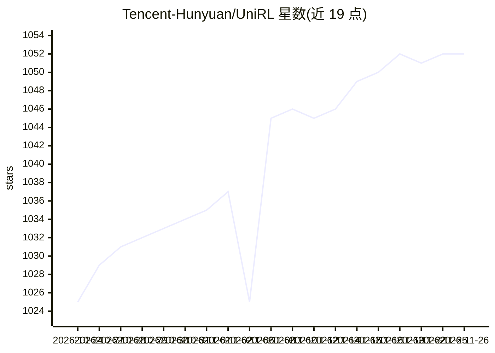

# Tencent-Hunyuan/UniRL

⭐ 1,052 · Python · NOASSERTION · 推送 2026-11-22 · [GitHub](https://github.com/Tencent-Hunyuan/UniRL) · [官网](https://unirl-project.github.io/unirl/) · 组织维护 · 中文 README

**统一多模态模型的强化学习后训练框架**

UniRL 是面向多模态模型家族的 RL 后训练框架，执行『生成样本→打分→计算优势→更新策略→同步权重回 rollout worker』的训练循环。采用分层可组合架构：训练入口加载 Hydra 配置并创建对应域 trainer，RL trainer 协调可插拔的 rollout 引擎、算法、模型包、奖励服务与共享分布式运行时（Ray DevicePool、FSDP、Transfer Queue、LoRA/全量权重同步）。支持 Diffusion RL、AR RL、SFT、Agentic RL、异步 RL 等训练路径，覆盖图像/视频扩散、VLM、LLM、统一模型等 20 余个模型配方。面向需要做模型 RL 后训练的研究者与工程师。

## 筛选速览

| 维度 | 判定 | 备注 |
|---|---|---|
| AI 角色 | `ai-ecosystem` | LLM/agent 周边工具 |
| 许可风险 | `none` | NOASSERTION |
| 部署形态 | `None` |  |
| 模型依赖 | local-ok | 支持本地模型 |
| 硬件要求 | — | 无带数字的原话,不猜 |
| 安装摩擦 | `low` | 无编译、无系统依赖或容器化 |
| 成熟度 | — | 结构信号不足 |

## 能力要点

- 单一套路覆盖图像/视频扩散、AR、统一 AR+扩散等多模态模型家族的 RL 后训练
- 自研算法 Flow-DPPO、DRPO、CPPO，并内置 GRPO、DiffusionNFT、DanceGRPO 等参考算法
- 8 类训练入口（Diffusion RL / AR RL / SFT / Agentic / 异步 RL 等）基于 Hydra 配置
- 基于 Ray、FSDP、Transfer Queue 的分布式运行时与 LoRA/全量权重同步

## 适用场景

- 对扩散模型（图像/视频生成）做 RL 后训练
- 对 LLM/VLM 跑 GRPO 类强化学习
- 训练带多轮工具调用的 agentic 模型
- 用 SFT 或异步 RL 流程训练自己的多模态模型

## 场景标签

`强化学习` · 领域:训练与推理

## 证据(README 行号)

> L1: UniRL — A Reinforcement Learning Framework for Unified Multimodal Models
> L31: UniRL is a layered, composable system. Each **training entrypoint** loads a
> L33: coordinate generation, scoring, and updates across pluggable

## 星数曲线

2026-10-24 1,025 → 2026-11-26 1,052（+27）

---
*卡片 v1 · prompt 1.4 · 生成 2026-11-24 · 置信度 high · 依据 README sha `cf66eabcc8aa` · [字段定义](../../DATASET.md)*
