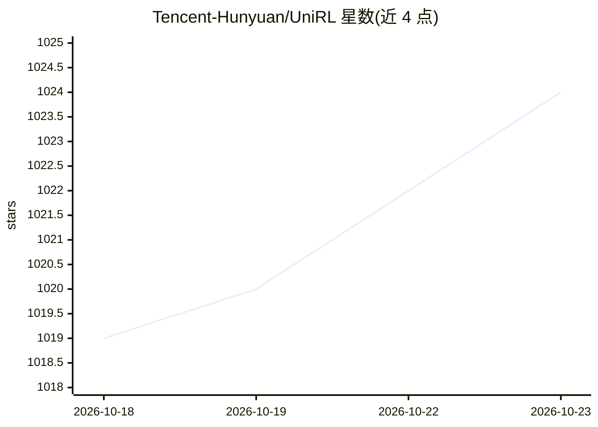

# Tencent-Hunyuan/UniRL

⭐ 1,024 · Python · NOASSERTION · 推送 2026-10-19 · [GitHub](https://github.com/Tencent-Hunyuan/UniRL) · [官网](https://unirl-project.github.io/unirl/) · 组织维护 · 中文 README

**多模态模型统一强化学习训练框架**

腾讯混元团队的强化学习后训练框架：用一条 RL 循环（生成样本、打分、计算优势、更新策略、回传权重到 rollout 引擎）覆盖图像/视频扩散、LLM/VLM、统一 AR+diffusion 等多类模型。采用分层可组合架构，训练入口加载 Hydra 配置，坐标可插拔的 rollout 引擎、算法、模型包与奖励服务，分布式运行时含 Ray DevicePool、FSDP、LoRA/全量权重同步。内置自研算法 Flow-DPPO/DRPO/CPPO 与 GRPO 等参考算法，支持 SFT、异步训练与多轮工具使用的 Agentic RL 等八种训练模式；安装依赖需另见 INSTALL.md。

## 筛选速览

| 维度 | 判定 | 备注 |
|---|---|---|
| AI 角色 | `ai-ecosystem` | LLM/agent 周边工具 |
| 许可风险 | `none` | NOASSERTION |
| 部署形态 | `None` |  |
| 模型依赖 | local-ok | 支持本地模型 |
| 硬件要求 | — | 无带数字的原话,不猜 |
| 安装摩擦 | `low` | 无编译、无系统依赖或容器化 |
| 成熟度 | — | 结构信号不足 |

## 能力要点

- 覆盖 20+ 模型的统一 RL 训练循环（扩散/AR/统一模型）
- 自研算法 Flow-DPPO、DRPO、CPPO 附带教程与可运行示例
- SGLang 与 vLLM(-Omni) 作为可插拔 rollout 引擎
- 八种训练模式含 Agentic RL 与分离 rollout 的异步训练

## 适用场景

- 对图像或视频扩散模型做 RL 后训练
- 训练 VLM/LLM 的多模态推理能力（GRPO 等）
- 用自研信任域算法做实验对比
- 搭建多轮工具使用场景的 Agentic RL 训练

## 场景标签

`强化学习` `微调` · 领域:训练与推理

## 证据(README 行号)

> L25: UniRL applies one RL post-training loop — generate samples, score them, compute
> L31: UniRL is a layered, composable system. Each **training entrypoint** loads a
> L33: coordinate generation, scoring, and updates across pluggable

## 星数曲线

2026-10-18 1,019 → 2026-10-23 1,024（+5）

---
*卡片 v1 · prompt 1.4 · 生成 2026-10-21 · 置信度 high · 依据 README sha `878bf8e6243c` · [字段定义](../../DATASET.md)*
