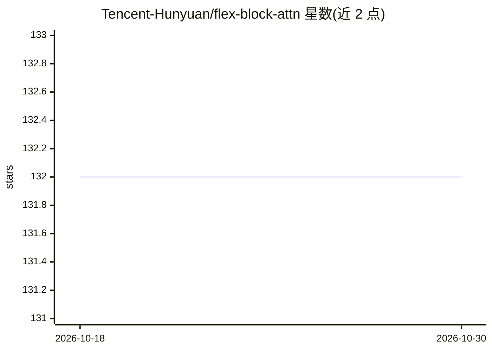

# Tencent-Hunyuan/flex-block-attn

⭐ 132 · Jupyter Notebook · NOASSERTION · 推送 2025-12-26 · [GitHub](https://github.com/Tencent-Hunyuan/flex-block-attn) · 组织维护 · 中文 README

**面向 Hunyuan Video 的块稀疏注意力 GPU 计算库**

腾讯混元开源的高效块稀疏注意力计算库，为 Hunyuan Video 的训练与推理设计，支持 STA、MOBA 与 SSTA（两者的混合）等稀疏注意力策略。基于 ThunderKittens 的注意力实现构建，面向 Hopper（SM90）架构 GPU 优化，提供类 PyTorch 的 mask 表达式以生成稀疏掩码。限制包括：head dim 必须为 128，q tile 为 16 的倍数、k/v tile 为 64 的倍数（推荐 384），序列长度须被 tile 大小整除，掩码仅支持块级。通过源码 setup.py 安装，需 CUDA 12.8。

## 筛选速览

| 维度 | 判定 | 备注 |
|---|---|---|
| AI 角色 | `ai-ecosystem` | LLM/agent 周边工具 |
| 许可风险 | `none` | NOASSERTION |
| 部署形态 | `None` |  |
| 模型依赖 | — | README 未给出锁定关系 |
| 硬件要求 | — | 无带数字的原话,不猜 |
| 安装摩擦 | `medium` | 含编译或系统依赖之一 |
| 成熟度 | — | 结构信号不足 |

## 能力要点

- 支持 STA / MOBA / SSTA 稀疏注意力策略，用于训练与推理
- 类 PyTorch 的 mask 表达式生成块级稀疏掩码
- 面向 Hopper（SM90）架构 GPU 优化，基于 ThunderKittens 构建
- 提供 H800 与 H20 上的 benchmark 结果（mask 生成/前反向耗时/显存）

## 适用场景

- 视频生成模型训练中的长序列稀疏注意力计算
- 在 Hopper GPU 上替换全量注意力以降低显存与耗时
- 复现或评测动态/静态稀疏注意力的性能基准

## 场景标签

`模型训练` · 领域:训练与推理

## 证据(README 行号)

> L4: Flex-Block-Attn is an efficient block sparse attention computation library specifically designed for Hunyuan Video. 
> L40: ### 🚀 Performance

## 星数曲线

2026-10-18 132 → 2026-10-30 132（+0）

---
*卡片 v1 · prompt 1.4 · 生成 2026-10-23 · 置信度 high · 依据 README sha `880bc0d1c1a3` · [字段定义](../../DATASET.md)*
