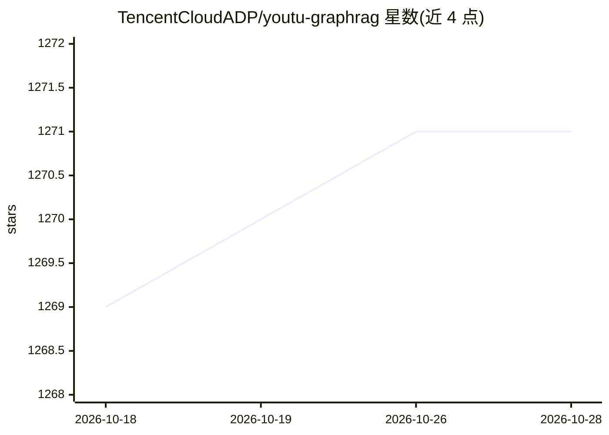

# TencentCloudADP/youtu-graphrag

⭐ 1,271 · Python · NOASSERTION · 推送 2026-02-26 · [GitHub](https://github.com/TencentCloudADP/youtu-graphrag) · [官网](https://arxiv.org/abs/2508.19855) · 组织维护 · 中文 README

**腾讯优图的 GraphRAG 框架：图谱构建+多智能体检索的复杂推理问答**

面向图检索增强生成（GraphRAG）的垂直统一 agentic 框架：以图 schema 为核心，提供种子 schema 引导的四级知识树构建（属性/关系三元组/关键词/社区）、融合拓扑与语义的社区检测、基于 IRCoT 的迭代反思式查询分解与并行检索，最终生成回答。支持通过单一 YAML 集中配置、neo4j 导入可视化，并对新领域做少量 schema 干预即可迁移。提供 Docker 与 Python 3.10 Web UI 两种运行方式，论文被 ICLR 2026 接收，附 Hugging Face 匿名评测数据集 AnonyRAG。限制：README 宣称的成本/精度提升为作者自报基准结果。

## 筛选速览

| 维度 | 判定 | 备注 |
|---|---|---|
| AI 角色 | `ai-ecosystem` | LLM/agent 周边工具 |
| 许可风险 | `permissive` | NOASSERTION |
| 部署形态 | `self-host` | docker 或自建部署 |
| 模型依赖 | — | README 未给出锁定关系 |
| 硬件要求 | — | 无带数字的原话,不猜 |
| 安装摩擦 | `low` | 无编译、无系统依赖或容器化 |
| 成熟度 | — | 结构信号不足 |

## 能力要点

- schema 引导的四级知识树构建与可扩展 schema
- 结构+语义双重感知的社区检测与层级知识树
- IRCoT 迭代反思的 agentic 查询分解与并行子问题处理
- 单一 YAML 集中配置与 neo4j 可视化导入

## 适用场景

- 在领域知识库上构建多跳推理问答系统
- 百科/论文/企业私有知识库的 GraphRAG 落地
- 用 AnonyRAG 数据集评测检索真实性能

## 场景标签

`RAG` `知识图谱` `多智能体` · 领域:Agent 开发

## 证据(README 行号)

> L19: **Youtu-GraphRAG** is a vertically unified agentic paradigm that jointly connects the entire framework as an intric
> L42: Based on our unified agentic paradigm for Graph Retrieval-Augmented Generation (GraphRAG), Youtu-GraphRAG introduce
> L110: We provide two approaches to run and experience the demo service. Considering the differences in the underlying en

## 星数曲线

2026-10-18 1,269 → 2026-10-28 1,271（+2）

---
*卡片 v1 · prompt 1.4 · 生成 2026-10-21 · 置信度 high · 依据 README sha `adbab1ce6939` · [字段定义](../../DATASET.md)*
