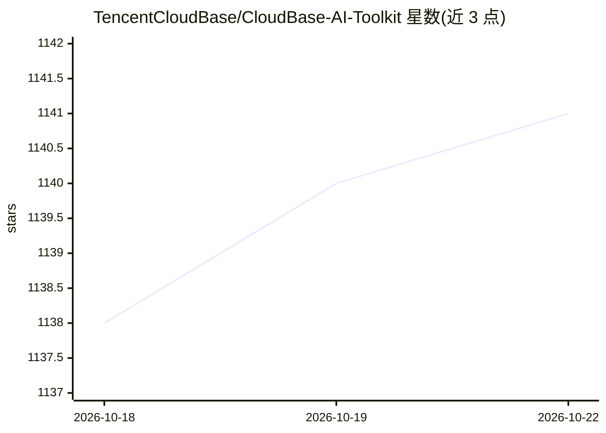

# TencentCloudBase/CloudBase-AI-Toolkit

⭐ 1,142 · TypeScript · MIT · 推送 2026-10-22 · [GitHub](https://github.com/TencentCloudBase/CloudBase-AI-Toolkit) · [官网](https://docs.cloudbase.net/ai/cloudbase-ai-toolkit/) · 组织维护 · 中文 README

**让 AI 编程工具直接操作腾讯云 CloudBase 后端的集成层**

腾讯 CloudBase 团队维护的 AI 编程工具集成层，由 Plugin（安装 MCP Server、Agent Skills、Hooks）、Agent Skills（Web/小程序/数据库/认证等场景技能）和 MCP Server 三部分组成。AI IDE 中的 agent 通过 MCP 在用户 CloudBase 环境内完成数据库 CRUD、云函数编写部署、认证与存储管理、静态托管与小程序发布。需自备 CloudBase 环境，敏感操作带确认机制；安装途径包括 npx 插件、全局 CLI 与手工 MCP 配置，要求 Node.js v18.15.0+。

## 筛选速览

| 维度 | 判定 | 备注 |
|---|---|---|
| AI 角色 | `ai-ecosystem` | LLM/agent 周边工具 |
| 许可风险 | `permissive` | MIT |
| 部署形态 | `library` | 以包/库形式分发 |
| 模型依赖 | — | README 未给出锁定关系 |
| 硬件要求 | — | 无带数字的原话,不猜 |
| 安装摩擦 | `low` | 无编译、无系统依赖或容器化 |
| 成熟度 | — | 结构信号不足 |

## 能力要点

- Plugin 一并安装 MCP Server、Agent Skills 与 Hooks，减少逐 IDE 配置
- MCP 覆盖数据库、云函数/Cloud Run、认证存储、部署与日志读取
- 支持远程 HTTP 连接模式，无需本地 Node，浏览器完成 OAuth 授权
- 列出 20+ 种 AI IDE/CLI 的接入路径

## 适用场景

- 在 Cursor、Claude Code 等 AI IDE 中对话式完成 CloudBase 后端开发与部署
- 用场景 Skills 约束 AI 按 CloudBase 实践写代码
- 通过对话管理数据库、云函数、静态托管与小程序发布

## 场景标签

`Agent 框架` · 领域:Agent 开发

## 证据(README 行号)

> L7: The CloudBase integration layer for AI coding tools: Plugin installs the stack, Skills steer how code is written, MC
> L54: CloudBase is Tencent Cloud’s AI-native all-in-one backend (database, storage, auth, cloud functions, Cloud Run, and
> L62: This repository ships the npm package `@cloudbase/cloudbase-mcp`, Skills, and AI plugins.

## 星数曲线

2026-10-18 1,138 → 2026-10-22 1,141（+3）

---
*卡片 v1 · prompt 1.4 · 生成 2026-10-21 · 置信度 high · 依据 README sha `37faf89fea41` · [字段定义](../../DATASET.md)*
