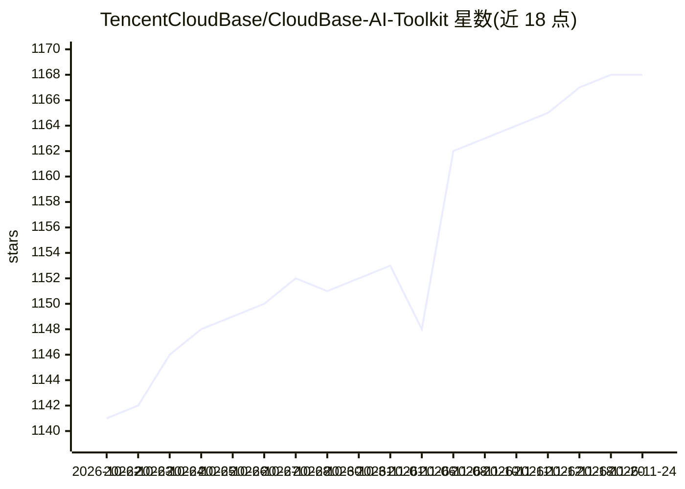

# TencentCloudBase/CloudBase-AI-Toolkit

⭐ 1,168 · TypeScript · MIT · 推送 2026-11-22 · [GitHub](https://github.com/TencentCloudBase/CloudBase-AI-Toolkit) · [官网](https://docs.cloudbase.net/ai/cloudbase-ai-toolkit/) · 组织维护 · 中文 README

**给 AI 编码工具接入腾讯云 CloudBase 后端的插件/Skills/MCP 工具集**

连接腾讯云 CloudBase（数据库、认证、云函数、存储、Cloud Run、托管）与 AI 编码工具的集成层，发布 npm 包 @cloudbase/cloudbase-mcp、Agent Skills 与 AI 插件。Plugin 一次性安装 MCP Server、Skills 与 Hooks；MCP 在对话中完成登录、数据读写、函数与托管管理、日志查看和部署；Skills 以场景知识约束代码写法。支持远程 HTTP、OAuth、静态凭证与本地 npx 四种连接方式，需自备 CloudBase 环境与 Node.js 18.15+。

## 筛选速览

| 维度 | 判定 | 备注 |
|---|---|---|
| AI 角色 | `ai-ecosystem` | LLM/agent 周边工具 |
| 许可风险 | `permissive` | MIT |
| 部署形态 | `library` | 以包/库形式分发 |
| 模型依赖 | locked-api |  |
| 硬件要求 | — | 无带数字的原话,不猜 |
| 安装摩擦 | `low` | 无编译、无系统依赖或容器化 |
| 成熟度 | — | 结构信号不足 |

## 能力要点

- Plugin/Skills/MCP 三层结构：安装、知识约束、运行时操作
- 远程 OAuth 与静态凭证双模式，另支持本地 npx 运行完整功能
- 列出 25 个支持 Plugin/Skills/MCP 的 AI IDE 及各自安装路径
- 破坏性操作要求点名目标的确认，凭证参数做指纹校验

## 适用场景

- 在 Cursor/Claude Code 等工具里用对话创建数据库、部署云函数
- 开发微信小程序或 Web 应用时让 AI 直接操作 CloudBase 后端
- 通过 CI 中的静态凭证自动部署与运维 CloudBase 环境

## 场景标签

`编码 Agent` · 领域:编码与开发

## 证据(README 行号)

> L7: The CloudBase integration layer for AI coding tools: Plugin installs the stack, Skills steer how code is written, MC
> L43: CloudBase is Tencent Cloud’s AI-native all-in-one backend (database, storage, auth, cloud functions, Cloud Run, and
> L51: This repository ships the npm package `@cloudbase/cloudbase-mcp`, Skills, and AI plugins.

## 星数曲线

2026-10-22 1,141 → 2026-11-24 1,168（+27）

---
*卡片 v1 · prompt 1.4 · 生成 2026-11-23 · 置信度 high · 依据 README sha `d90485eff8ef` · [字段定义](../../DATASET.md)*
