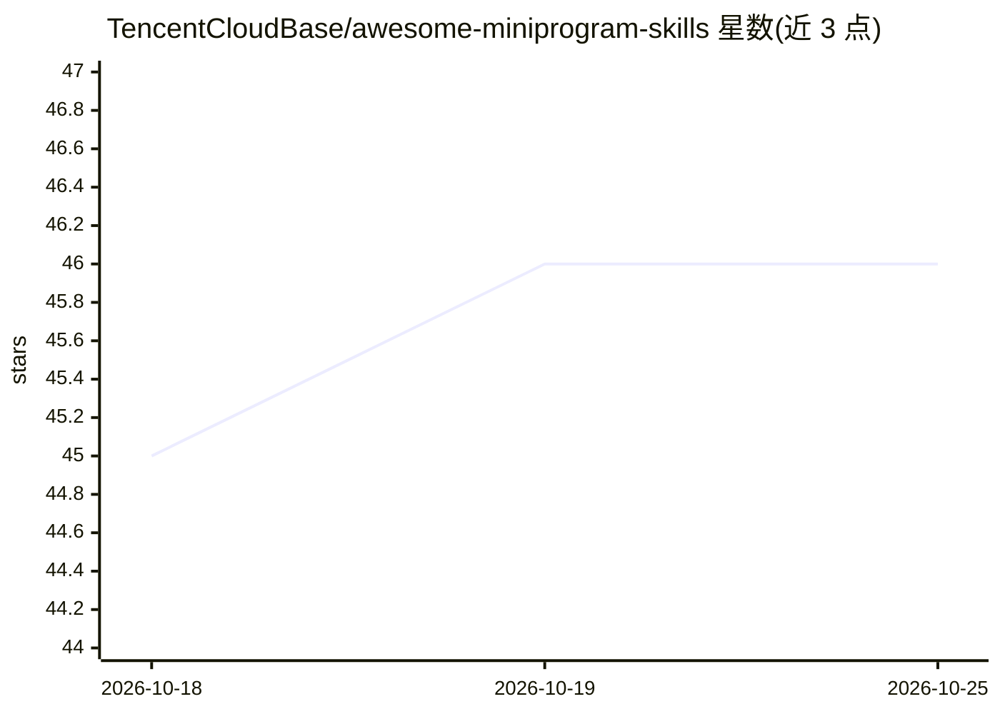

# TencentCloudBase/awesome-miniprogram-skills

⭐ 46 · JavaScript · MIT · 推送 2026-06-18 · [GitHub](https://github.com/TencentCloudBase/awesome-miniprogram-skills) · 组织维护 · 中文 README

**微信小程序 AI Skill 示例集合，覆盖 14 个开箱即用场景**

腾讯 CloudBase 团队维护的微信小程序 AI 开发模式 Skill 示例集合：把小程序业务封装成 AI 可调用的 Skill，含外卖点餐、医院挂号、打车、微信支付、AI 文本/图片生成等 14 个示例（各含原子 API 与组件）。数据流为 AI 路由（SKILL.md 匹配）→原子接口→原子组件，每个 Skill 自包含前端代码与可选云函数、数据库定义；支持预览模式（本地 seed/mock，无需云环境）与正式模式（独立云函数+云数据库）。配套 mp-skills CLI 创建/搜索/评测 Skill，推荐配合 CloudBase Skill 与 MCP 工具部署调试。

## 筛选速览

| 维度 | 判定 | 备注 |
|---|---|---|
| AI 角色 | `ai-knowledge` | 知识聚合/清单类 |
| 许可风险 | `permissive` | MIT |
| 部署形态 | `library` | 以包/库形式分发 |
| 模型依赖 | — | README 未给出锁定关系 |
| 硬件要求 | — | 无带数字的原话,不猜 |
| 安装摩擦 | `low` | 无编译、无系统依赖或容器化 |
| 成熟度 | — | 结构信号不足 |

## 能力要点

- 14 个开箱即用 Skill 示例（点餐/挂号/打车/支付/AI 生成等）
- 双模式运行：预览模式走本地 seed/mock，无需云开发环境
- mp-skills CLI 支持创建、搜索 Skill 并内置 AI 评测校验工具
- 每个 Skill 自包含前端代码与可选云函数、数据库集合定义

## 适用场景

- 参考现成 Skill 快速把小程序业务接入 AI 开发模式
- 用 mp-skills CLI 创建新 AI 小程序或改造现有小程序
- 本地预览模式体验完整 AI Skill 数据流后再接入云环境

## 场景标签

`教程课程` · 领域:学习与行业

## 证据(README 行号)

> L10: 微信小程序 **AI 开发模式** 的 Skill 集合。
> L12: > 把小程序业务封装成 AI 可调用的 Skill —— 用户通过自然语言就能完成点单、排队、查天气等操作。

## 星数曲线

2026-10-18 45 → 2026-10-25 46（+1）

---
*卡片 v1 · prompt 1.4 · 生成 2026-10-25 · 置信度 high · 依据 README sha `4d37f772a6a5` · [字段定义](../../DATASET.md)*
