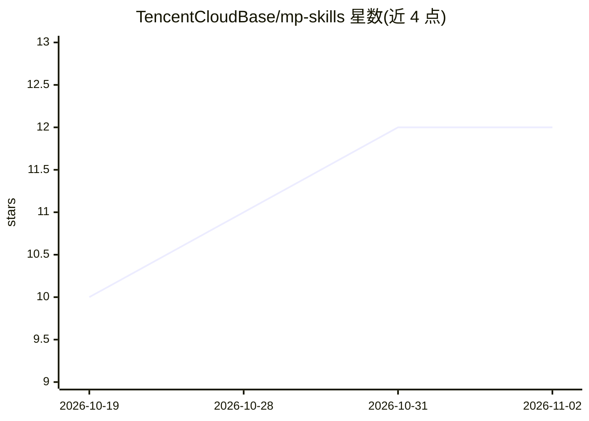

# TencentCloudBase/mp-skills

⭐ 12 · TypeScript · 推送 2026-06-22 · [GitHub](https://github.com/TencentCloudBase/mp-skills) · 组织维护 · 中文 README

**微信小程序 AI Skill 开发 CLI：创建、安装、校验与评测 Skill**

面向微信小程序开发者的 npm CLI 工具，服务于微信 AI 开发模式：跨注册仓库搜索与安装 Skill（GitHub/URL/本地路径），一键创建带 AI Skill 支持的小程序项目骨架或将现有项目改造为支持 AI 开发模式；agent 模式调用 opencode 让大模型按项目上下文生成符合规范的 Skill；内置静态校验、原子接口执行、组件渲染，并集成官方 wxa-skills-eval 做端到端评测（依赖微信开发者工具）。LLM 凭证采用 BYOK，内置 DeepSeek、智谱 GLM、Kimi、MiniMax、CloudBase 网关预设，凭证可持久化到 .env。

## 筛选速览

| 维度 | 判定 | 备注 |
|---|---|---|
| AI 角色 | `ai-ecosystem` | LLM/agent 周边工具 |
| 许可风险 | `none` | — |
| 部署形态 | `library` | 以包/库形式分发 |
| 模型依赖 | locked-api |  |
| 硬件要求 | — | 无带数字的原话,不猜 |
| 安装摩擦 | `low` | 无编译、无系统依赖或容器化 |
| 成熟度 | — | 结构信号不足 |

## 能力要点

- 跨注册仓库的 Skill 发现、安装、更新、移除（skills-lock.json 版本追踪）
- agent 模式经 opencode 由大模型分析项目生成符合规范的 Skill
- validate/execute/render 三级校验加 wxa-skills-eval 端到端评测（official/agent 两模式）
- BYOK 多 LLM 提供方预设与交互式凭证向导，凭证写入 .env

## 适用场景

- 把现有小程序改造为支持微信 AI 开发模式
- 从零创建带 AI Skill 的小程序项目并安装社区 Skill
- 用大模型辅助生成并自动评测自定义 Skill 的质量
- 在 CI 中对 Skill 做校验与无界面评测

## 场景标签

`Agent 框架` `模型评测` `代码生成` · 领域:Agent 开发

## 证据(README 行号)

> L12: 小程序 Skill 开发工具，支持快速创建新的 AI 小程序和 Skill，或将现有小程序改造为支持 AI 开发模式，并内置 AI 评测校验工具，保障 Skill 执行质量和稳定性。
> L21: - 🧪 **端到端质量评估**：集成官方评测工具（`wxa-skills-eval`），支持 official 和 agent 两种评估模式，自动生成测试用例并执行（`eval`）
> L22: - 🔑 **多 LLM 提供方**：内置 DeepSeek、智谱 GLM、Kimi、MiniMax、CloudBase 网关等提供方预设，支持 BYOK（Bring Your Own Key）

## 星数曲线

2026-10-19 10 → 2026-11-02 12（+2）

---
*卡片 v1 · prompt 1.4 · 生成 2026-11-01 · 置信度 high · 依据 README sha `2a1445cbdda3` · [字段定义](../../DATASET.md)*
