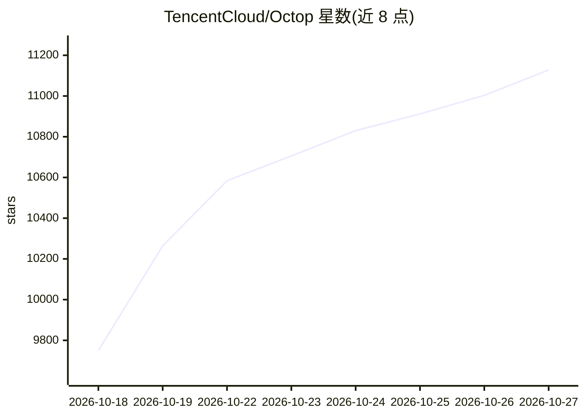

# TencentCloud/Octop

⭐ 11,128 · Python · MIT · 推送 2026-10-26 · [GitHub](https://github.com/TencentCloud/Octop) · [官网](https://octop.cloud) · 组织维护 · 中文 README

**自托管多用户多智能体 AI 助手平台，面向家庭与小团队**

Octop 是腾讯云开源的自托管 AI 助手平台：单进程运行，同时提供 Web 仪表盘、CLI、桌面客户端与飞书/钉钉/QQ/微信/Telegram/Discord/企业微信等 IM 渠道及 HTTP/SSE/WebSocket API。核心机制包括多专家（agent）与专家库/专家市场、16 种 MBTI 人格模板、AgentTeams 协调多专家（Beta）、RAG 知识库、Octop Memory 记忆随工作区迁移、OAuth+MCP 连接器生态，以及 ACP 双向集成（可委托 OpenCode/Claude Code 等编码 agent）。安全方面提供 JWT 多用户隔离、工具审批与 PII 脱敏；数据默认存于本机 ~/.octop/（SQLite，可选 PostgreSQL）。安装通过一键脚本、桌面安装包或 PyPI。限制：AgentTeams 为 Beta，移动端在内测。

## 筛选速览

| 维度 | 判定 | 备注 |
|---|---|---|
| AI 角色 | `ai-native` | 本体是模型或模型工具 |
| 许可风险 | `permissive` | MIT |
| 部署形态 | `desktop` | 安装包/桌面程序 |
| 模型依赖 | — | README 未给出锁定关系 |
| 硬件要求 | — | 无带数字的原话,不猜 |
| 安装摩擦 | `low` | 无编译、无系统依赖或容器化 |
| 成熟度 | `idea` | |

## 能力要点

- 单进程自托管，Web/CLI/桌面端/7+ IM 渠道统一接入
- 多用户多专家架构：专家库、专家市场、AgentTeams 多专家调度（Beta）
- RAG 知识库与随工作区迁移的可携带记忆（Octop Memory）
- ACP 双向集成：对外提供 stdio ACP 服务，也可委托 OpenCode/Claude Code 等编码 agent

## 适用场景

- 家庭共用一个 AI 助手实例，成员各自配备不同专家与知识库
- 小团队把 AI 助手接入飞书/钉钉/企业微信群聊，用自然语言配置定时任务
- 开发者通过 ACP 在 IDE/终端中调用自托管 agent，或委托编码 agent 完成任务
- 通过浏览器自动化与远程桌面功能执行网页操作和 GUI 应用任务

## 场景标签

`AI 助手` `多智能体` `RAG` `Agent 记忆` · 领域:Agent 开发

## 证据(README 行号)

> L28: **Octop** is an open-source, self-hosted AI assistant. It's not just a tool — it's a digital life form that can ope
> L55: Octop is a self-hosted AI assistant platform for households and small teams. It runs a single process that serves a
> L61: - **Personal assistant** — let a dedicated agent write weekly reports, organize notes, and manage your schedule; me

## 星数曲线

2026-10-18 9,750 → 2026-10-27 11,128（+1,378）

---
*卡片 v1 · prompt 1.4 · 生成 2026-10-20 · 置信度 mid · 依据 README sha `3447a4f7f443` · [字段定义](../../DATASET.md)*
