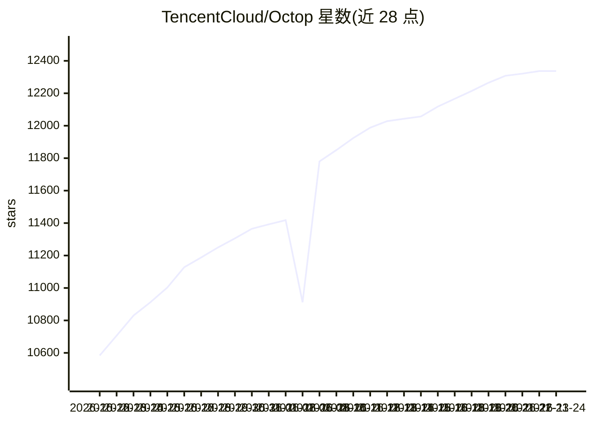

# TencentCloud/Octop

⭐ 12,422 · Python · MIT · 推送 2026-11-23 · [GitHub](https://github.com/TencentCloud/Octop) · [官网](https://octop.cloud) · 组织维护 · 中文 README

**自托管多用户多 Agent AI 助手平台**

Octop 是一个开源、自托管的 AI 助手平台，面向家庭与小团队：单进程提供 Web 控制台、CLI、IM 通道（飞书、钉钉、QQ、微信、Telegram、Discord、企业微信等）与 cron 自动化，数据保存在本机 ~/.octop/ 下。核心机制包括多专家（每专家独立工作区、通道与 cron）、AgentTeams 协调器调度多专家（Beta）、可移植记忆（Octop Memory）、RAG 知识库、OAuth/MCP 连接器，以及 ACP 双向集成（对外提供 agent 服务，也可委托 OpenCode/Claude Code 执行编码任务）。默认 SQLite，可选 PostgreSQL。

## 筛选速览

| 维度 | 判定 | 备注 |
|---|---|---|
| AI 角色 | `ai-native` | 本体是模型或模型工具 |
| 许可风险 | `permissive` | MIT |
| 部署形态 | `desktop` | 安装包/桌面程序 |
| 模型依赖 | — | README 未给出锁定关系 |
| 硬件要求 | — | 无带数字的原话,不猜 |
| 安装摩擦 | `low` | 无编译、无系统依赖或容器化 |
| 成熟度 | — | 结构信号不足 |

## 能力要点

- 单进程自托管：Web 控制台、CLI、IM 通道与 cron 共用一个控制面数据库
- 多用户专家体系：每用户多名专家，内置专家库与专家市场，16 种 MBTI 人格模板
- 可插拔工作区后端：本地磁盘、Docker 沙箱、PostgreSQL、COS/S3
- ACP 双向集成与浏览器/终端 AI 能力（CDP 浏览器自动化、AI 辅助命令执行）

## 适用场景

- 家庭共享部署：一个管理员账户，各成员使用不同专家和知识库
- 通过飞书/钉钉/微信等 IM 把任务路由到群聊中的 agent
- 把编码任务委托给 OpenCode/Claude Code，或在浏览器终端里排障
- 用自然语言配置定时任务，让 agent 按时推送或执行作业

## 场景标签

`AI 助手` `多智能体` `RAG` `浏览器自动化` · 领域:Agent 开发

## 证据(README 行号)

> L28: **Octop** is an open-source, self-hosted AI assistant. It's not just a tool — it's a digital life form that can ope
> L55: Octop is a self-hosted AI assistant platform for households and small teams. It runs a single process that serves a
> L84: - **Octop Harness** — Agent runtime: model routing, tools, skills, and conversation checkpointing.

## 星数曲线

2026-10-22 10,584 → 2026-11-24 12,337（+1,753）

---
*卡片 v1 · prompt 1.4 · 生成 2026-11-22 · 置信度 mid · 依据 README sha `9e6f4131b338` · [字段定义](../../DATASET.md)*
