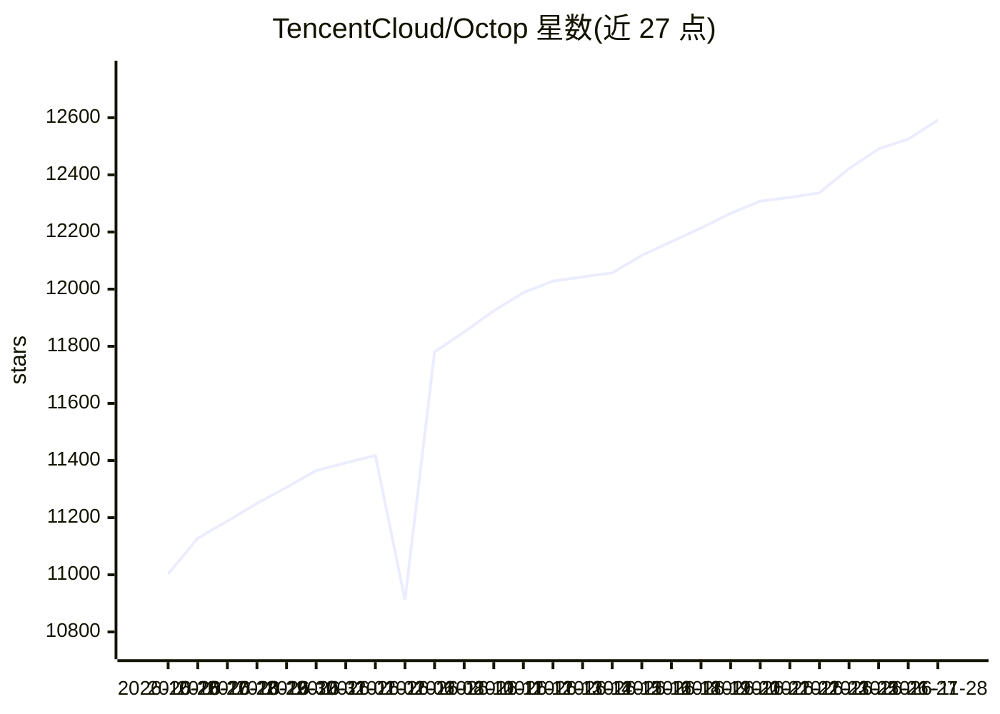

# TencentCloud/Octop

⭐ 12,592 · Python · MIT · 推送 2026-11-27 · [GitHub](https://github.com/TencentCloud/Octop) · [官网](https://octop.cloud) · 组织维护 · 中文 README

**自托管多智能体 AI 助手平台：多用户、多 Agent、隐私本地化**

Octop 是开源自托管 AI 助手平台，面向家庭与小团队。单进程运行 Web 控制台、CLI、IM 渠道（飞书/钉钉/QQ/微信/Telegram/Discord 等）与 cron 定时任务，状态存于 ~/.octop/（默认 SQLite，可选 PostgreSQL）。核心机制：Octop Harness Agent 运行时（模型路由、工具、技能、会话检查点）、Octop Memory 层级记忆、RAG 知识库、OAuth+MCP 连接器、JWT 多用户隔离与工具审批。提供 16 种 MBTI 人格模板与 AgentTeams 协调调度（Beta）。

## 筛选速览

| 维度 | 判定 | 备注 |
|---|---|---|
| AI 角色 | `ai-native` | 本体是模型或模型工具 |
| 许可风险 | `permissive` | MIT |
| 部署形态 | `desktop` | 安装包/桌面程序 |
| 模型依赖 | — | README 未给出锁定关系 |
| 硬件要求 | — | 无带数字的原话,不猜 |
| 安装摩擦 | `low` | 无编译、无系统依赖或容器化 |
| 成熟度 | — | 结构信号不足 |

## 能力要点

- 多用户多专家架构：每专家独立工作区、providers、渠道与 cron
- 可插拔工作区后端：本地磁盘、Docker 沙箱、PostgreSQL、COS/S3
- ACP 双向集成：对外提供 stdio ACP 服务，向内委托 OpenCode/Claude Code 等
- 便携记忆系统（Octop Memory）随工作区迁移，RAG 知识库共享

## 适用场景

- 个人助理：让专属 Agent 写周报、整理笔记、管理日程
- 家庭共享：一个管理员账户，各成员分配不同专家 Agent
- 团队协作：通过飞书/钉钉/企微群聊路由任务给并行 Agent
- 开发者：经 ACP 把编码任务委托给外部 coding agent

## 场景标签

`AI 助手` `多智能体` `Agent 记忆` `RAG` · 领域:Agent 开发

## 证据(README 行号)

> L28: **Octop** is an open-source, self-hosted AI assistant. It's not just a tool — it's a digital life form that can ope
> L55: Octop is a self-hosted AI assistant platform for households and small teams. It runs a single process that serves a

## 星数曲线

2026-10-26 11,003 → 2026-11-28 12,592（+1,589）

---
*卡片 v1 · prompt 1.4 · 生成 2026-11-28 · 置信度 low · 依据 README sha `de0c12e35af6` · [字段定义](../../DATASET.md)*
