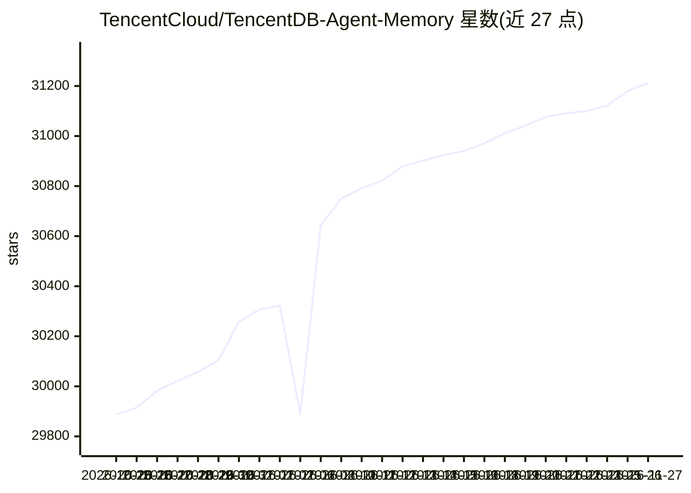

# TencentCloud/TencentDB-Agent-Memory

⭐ 31,213 · TypeScript · NOASSERTION · 推送 2026-11-26 · [GitHub](https://github.com/TencentCloud/TencentDB-Agent-Memory) · [官网](https://tencentdb-agent-memory.com/) · 组织维护 · 中文 README

**为 AI Agent 团队提供可治理、可共享记忆资产的记忆中枢**

面向使用 AI Agent 的团队，将对话、文档与代码转化为四类可复用记忆资产：Chat Memory、Skill、Wiki（带链接图的结构化知识页）与 CodeGraph（代码符号与调用关系索引）。通过 Memory Hub 面板进行资产的审核、共享、权限控制与绑定分发；Agent 侧通过指向 Proxy 的 base URL 接入，多数客户端无需插件或 MCP。支持冷启动导入代码库、文档与历史会话。MongoDB 存储后端为实验性且默认关闭。以 git clone 部署三个服务运行。

## 筛选速览

| 维度 | 判定 | 备注 |
|---|---|---|
| AI 角色 | `ai-ecosystem` | LLM/agent 周边工具 |
| 许可风险 | `permissive` | NOASSERTION |
| 部署形态 | `None` |  |
| 模型依赖 | — | README 未给出锁定关系 |
| 硬件要求 | — | 无带数字的原话,不猜 |
| 安装摩擦 | `low` | 无编译、无系统依赖或容器化 |
| 成熟度 | — | 结构信号不足 |

## 动量与使用信号

- 维护:`active` — 距上次 push 2.8 天,年发版 21,28 位贡献者
- 涨星:近 1 天 **+211**(自 20261016 起算)
- 平台:— · 协议:MCP

## 能力要点

- 四类记忆资产：Chat Memory、Skill、LLM-Wiki、CodeGraph
- 一个 Proxy 接入多客户端，多数无需插件/hook/MCP server
- private/team/restricted/agent 四级可见性与 ACL 权限控制
- 冷启动导入：代码库、文档与历史会话自动提取资产

## 适用场景

- 为多人协作的 Agent 团队统一管理与共享经验资产
- 把已有代码库和文档导入后让新 Agent 免于从零学习
- 给不同角色 Agent 分配各自所需的记忆与技能

## 场景标签

`Agent 记忆` `知识库管理` · 领域:Agent 开发

## 证据(README 行号)

> L47: One Proxy, unchanged protocol, zero-code integration — point the Agent's base URL to the Proxy and configure its Us
> L88: **Memory Hub** for Agent teams closes the loop across the entire experience lifecycle: work produces assets, assets
> L91: 2. **Portable & multi-Agent compatible**: Memory assets are decoupled from Agent frameworks — they can move across 

## 星数曲线

2026-10-25 29,888 → 2026-11-27 31,213（+1,325）

---
*卡片 v1 · prompt 1.4 · 生成 2026-11-22 · 置信度 high · 依据 README sha `fc1158c42089` · [字段定义](../../DATASET.md)*
