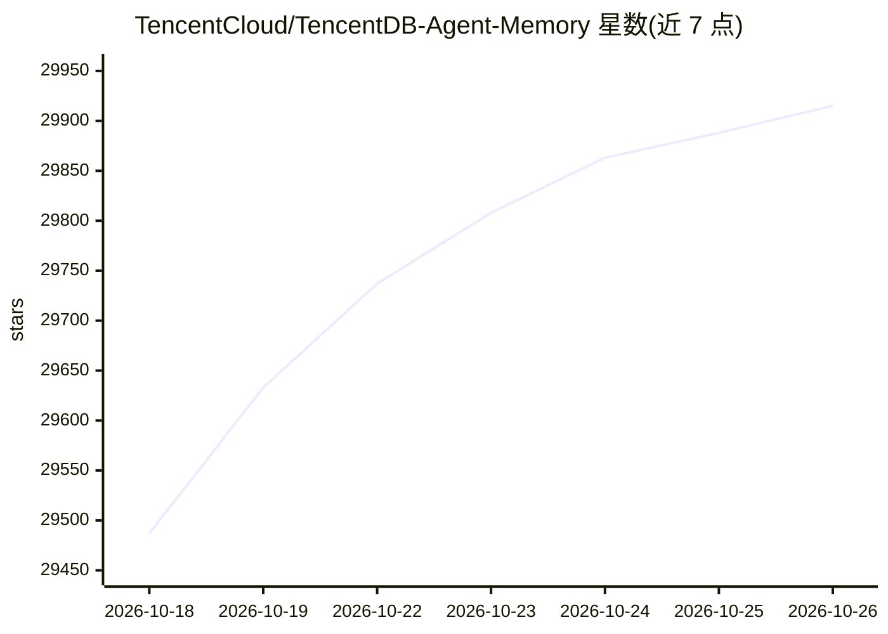

# TencentCloud/TencentDB-Agent-Memory

⭐ 29,915 · TypeScript · NOASSERTION · 推送 2026-10-21 · [GitHub](https://github.com/TencentCloud/TencentDB-Agent-Memory) · [官网](https://tencentcloud.github.io/TencentDB-Agent-Memory/) · 组织维护 · 中文 README

**给 AI Agent 团队用的共享记忆中枢，沉淀可复用资产**

由腾讯云维护的团队级 Agent 记忆中枢：把对话、文档与代码自动转换为四类记忆资产（Chat Memory、Skill、LLM-Wiki、CodeGraph），统一注册为 Memory Asset，经 Memory Hub 面板完成审核、共享、版本与 ACL 管理，并通过一个 Proxy 按固定绑定分发给不同 Agent。对话按 L0–L3 分层蒸馏，检索采用 BM25+向量+RRF 并受条目数、字符预算与超时限制。部署为 memory-core、memory-hub、proxy 三个服务，Node 环境运行；MongoDB 存储后端为实验性且默认关闭。

## 筛选速览

| 维度 | 判定 | 备注 |
|---|---|---|
| AI 角色 | `ai-native` | 本体是模型或模型工具 |
| 许可风险 | `permissive` | NOASSERTION |
| 部署形态 | `None` |  |
| 模型依赖 | locked-api |  |
| 硬件要求 | — | 无带数字的原话,不猜 |
| 安装摩擦 | `low` | 无编译、无系统依赖或容器化 |
| 成熟度 | `idea` | |

## 动量与使用信号

- 维护:`active` — 距上次 push 2.8 天,年发版 21,28 位贡献者
- 涨星:近 1 天 **+211**(自 20261016 起算)
- 平台:— · 协议:MCP

## 能力要点

- 四类记忆资产：Chat Memory、Skill、Wiki、CodeGraph，统一注册与分发
- 单 Proxy 零代码接入：改 base URL 即可，无需插件或 MCP 服务器
- L0–L3 分层记忆与 BM25+向量+RRF 混合检索
- private/team/restricted/agent 四级可见性与 ACL 权限控制

## 适用场景

- Agent 团队共享沉淀的工作流与调试经验
- 导入已有代码库与文档让新 Agent 冷启动
- 给不同角色的 Agent 装配各自需要的记忆资产
- 控制团队记忆的归属、版本与访问权限

## 场景标签

`Agent 记忆` · 领域:Agent 开发

## 证据(README 行号)

> L64: # What is TencentDB Agent Memory?
> L78: **Memory Hub** for Agent teams closes the loop across the entire experience lifecycle: work produces assets, assets
> L80: 1. **Automatic asset extraction**: Extract Chat Memory and Skills from conversations and tasks; convert documents a

## 星数曲线

2026-10-18 29,487 → 2026-10-26 29,915（+428）

---
*卡片 v1 · prompt 1.4 · 生成 2026-10-18 · 置信度 high · 依据 README sha `85001301661f` · [字段定义](../../DATASET.md)*
