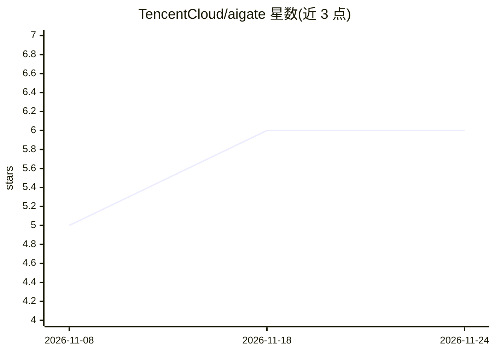

# TencentCloud/aigate

⭐ 6 · Go · Apache-2.0 · 推送 2026-11-03 · [GitHub](https://github.com/TencentCloud/aigate) · 组织维护 · 中文 README

**面向企业团队的自托管单二进制 LLM 网关**

单二进制、自托管的 LLM API 网关，将 OpenAI 与 Anthropic 两种协议统一到一个端点，客户端与上游协议不一致时进行转换，一致时原生透传。内置按 key 的模型路由与回退、四级 token 配额（全局→模型→用户→key）、BYOK 密钥绑定、AES-256-GCM 加密的凭据保管、HMAC-SHA256 签名 webhook、带 SSRF 防护的出站路径与用量核算导出。本地用 SQLite，生产用 MySQL，仅提供 API 无 Web UI，Go 1.24+ 源码构建或 Docker 容器运行。

## 筛选速览

| 维度 | 判定 | 备注 |
|---|---|---|
| AI 角色 | `ai-ecosystem` | LLM/agent 周边工具 |
| 许可风险 | `permissive` | Apache-2.0 |
| 部署形态 | `self-host` | docker 或自建部署 |
| 模型依赖 | — | README 未给出锁定关系 |
| 硬件要求 | — | 无带数字的原话,不猜 |
| 安装摩擦 | `low` | 无编译、无系统依赖或容器化 |
| 成熟度 | — | 结构信号不足 |

## 能力要点

- OpenAI 与 Anthropic 双协议入口与双上游适配器，含 SSE 透传
- 四级 token 配额与 per-key 路由规则（模型名回退、max_tokens 上限）
- BYOK 按绑定存密、凭据 AES-256-GCM 加密、密钥过期与轮换生命周期
- 带 SSRF 防护（URL 校验、拨号时重解析、重定向检查）的出站通道

## 适用场景

- 企业内部多团队统一模型接入点并按 key 分配配额
- 让持有自有 API key 的用户接入 BYOK 模型
- 需要 OpenAI/Anthropic 协议互转的混合上游部署
- 记录并导出各 key 的 token 用量与日聚合数据

## 场景标签

`模型网关` · 领域:Agent 开发

## 证据(README 行号)

> L12: **Tencent Cloud AIGate is a self-hosted, single-binary LLM gateway.** It puts
> L13: OpenAI and Anthropic behind one endpoint and makes the enterprise requirements —

## 星数曲线

2026-11-08 5 → 2026-11-24 6（+1）

---
*卡片 v1 · prompt 1.4 · 生成 2026-11-20 · 置信度 high · 依据 README sha `54af393428c9` · [字段定义](../../DATASET.md)*
