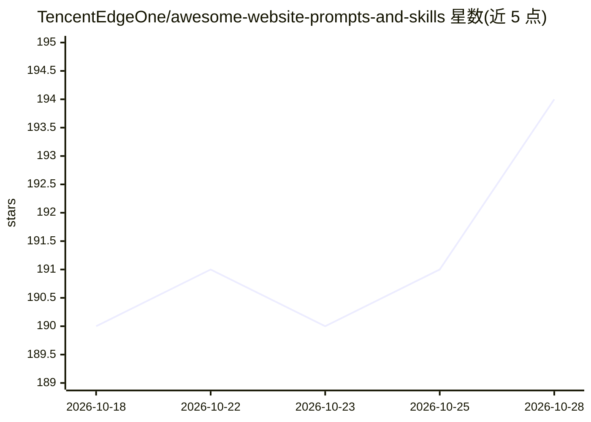

# TencentEdgeOne/awesome-website-prompts-and-skills

⭐ 194 · HTML · MIT · 推送 2026-06-04 · [GitHub](https://github.com/TencentEdgeOne/awesome-website-prompts-and-skills) · [官网](https://edgeone.ai/awesome-website-prompts-and-skills?from=github) · 组织维护 · 中文 README

**腾讯 EdgeOne 维护的 AI 建站 Prompt 与 Skill 作品合集**

Tencent EdgeOne 维护的网站资源合集，同时作为「WorkBuddy × Tencent EdgeOne AI Prompts × Skills 挑战赛」官方作品池，收录 166 件开发者作品（116 个 Prompt + 50 个 Skill）。Prompt 是直接粘贴给 AI 编程工具的建站提示词；Skill 遵循 Anthropic Skills 规范，封装特定类型网站的搭建 SOP。所有作品通过 EdgeOne Pages 部署，可按需接入登录、支付、AI 等后端服务。使用方式为浏览画廊、点击封面查看内容并复刻。

## 筛选速览

| 维度 | 判定 | 备注 |
|---|---|---|
| AI 角色 | `ai-knowledge` | 知识聚合/清单类 |
| 许可风险 | `permissive` | MIT |
| 部署形态 | `None` |  |
| 模型依赖 | — | README 未给出锁定关系 |
| 硬件要求 | — | 无带数字的原话,不猜 |
| 安装摩擦 | `low` | 无编译、无系统依赖或容器化 |
| 成熟度 | — | 结构信号不足 |

## 能力要点

- 收录 166 件作品：116 个 Prompt + 50 个 Skill
- Skill 遵循 Anthropic Skills 规范，封装建站 SOP
- 所有作品通过 EdgeOne Pages 部署（全球 CDN 加速 + 安全防护）
- 作为 WorkBuddy × Tencent EdgeOne 挑战赛官方作品池

## 适用场景

- 为 AI 编程工具寻找现成的建站提示词
- 安装 Skill 让 AI 按流程搭建带登录/支付/AI 能力的完整网站
- 浏览挑战赛参赛作品并一键复刻同款网站

## 场景标签

`提示工程` `精选清单` · 领域:Agent 开发

## 证据(README 行号)

> L16: 这个仓库是 **Tencent EdgeOne** 维护的**网站资源合集**，同时也是「**WorkBuddy × Tencent EdgeOne AI Prompts × Skills 挑战赛**」的官方作品池——目前收录了 
> L26: |**Prompts**|直接喂给 AI 编程工具的**建站提示词**|复制 Prompt → 粘贴给 AI → AI 帮你生成并部署完整网站|
> L27: |**Skills**|遵循 Anthropic Skills 规范 的**可复用建站能力包**，封装了特定类型网站的搭建 SOP|安装 Skill → 一句话触发 → AI 按 SOP 搭站并使用到 EdgeOne Pages 

## 星数曲线

2026-10-18 190 → 2026-10-28 194（+4）

---
*卡片 v1 · prompt 1.4 · 生成 2026-10-22 · 置信度 high · 依据 README sha `548fd286936e` · [字段定义](../../DATASET.md)*
