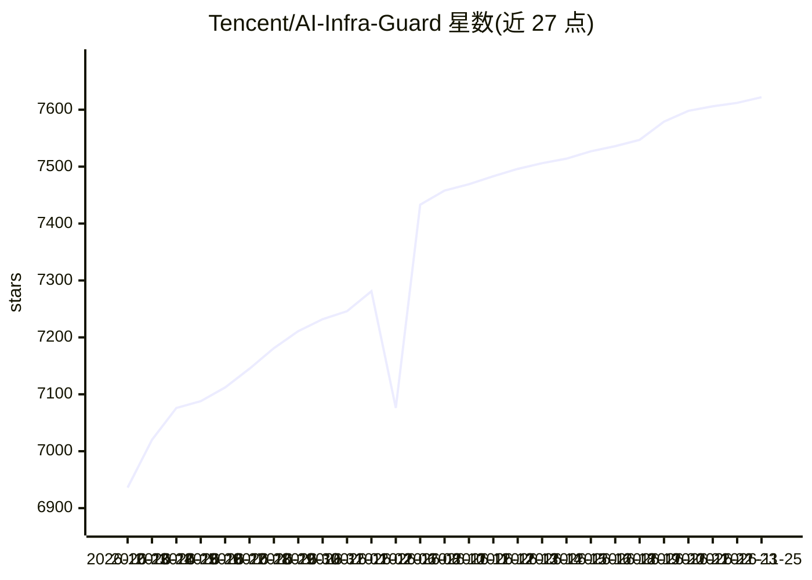

# Tencent/AI-Infra-Guard

⭐ 7,622 · Python · Apache-2.0 · 推送 2026-11-23 · [GitHub](https://github.com/Tencent/AI-Infra-Guard) · [官网](https://tencent.github.io/AI-Infra-Guard/) · 组织维护 · 中文 README

**给企业与开发者一站式检测 AI 系统/模型/Agent 安全风险的平台**

腾讯朱雀实验室开源的 AI 红队测试平台，覆盖 AI 基础设施指纹与漏洞扫描、MCP 服务与 Agent Skill 目录审计、面向运行中 Agent 的测试提示发送、以及基于 OpenAI 兼容 API 的 LLM 越狱与安全合规评估。以 Docker Compose 提供 Web 平台（8088 端口），六个子工具可经 pip 单独以命令行使用。README 声明其无身份认证机制，不应部署于公网。

## 筛选速览

| 维度 | 判定 | 备注 |
|---|---|---|
| AI 角色 | `ai-ecosystem` | LLM/agent 周边工具 |
| 许可风险 | `permissive` | Apache-2.0 |
| 部署形态 | `self-host` | docker 或自建部署 |
| 模型依赖 | — | README 未给出锁定关系 |
| 硬件要求 | — | 无带数字的原话,不猜 |
| 安装摩擦 | `low` | 无编译、无系统依赖或容器化 |
| 成熟度 | — | 结构信号不足 |

## 能力要点

- AI 基础设施扫描：对域名/IP/URL 匹配指纹与漏洞
- MCP 服务源码目录扫描与 Skill 目录审计，输出 SARIF
- 针对 OpenAI 兼容 API 模型的越狱评估与安全合规检查
- 插件化贡献：指纹 YAML、漏洞规则、MCP 规则、评估数据集目录

## 适用场景

- 部署前扫描内部 AI 基础设施组件的已知漏洞
- 审计团队使用的 MCP 服务器与 Agent Skill 的安全风险
- 对自有或第三方 LLM 做越狱与不安全提示拒绝能力评估

## 场景标签

`网络安全` `模型评测` · 领域:评测与运维

## 证据(README 行号)

> L39:  A.I.G (AI-Infra-Guard) brings together OpenClaw security checks, Agent security scanning, AI tool and skill scanni
> L84: Note: The AI-Infra-Guard project is positioned as an AI red teaming platform for internal use by enterprises or ind
> L92: ### AI Infrastructure Scan

## 星数曲线

2026-10-23 6,936 → 2026-11-25 7,622（+686）

---
*卡片 v1 · prompt 1.4 · 生成 2026-11-22 · 置信度 high · 依据 README sha `f97c0b77cd67` · [字段定义](../../DATASET.md)*
