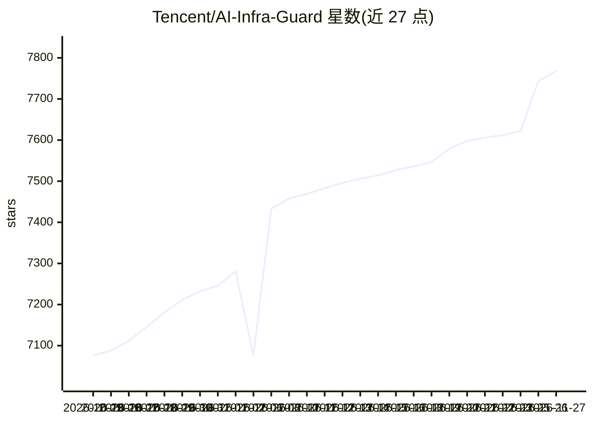

# Tencent/AI-Infra-Guard

⭐ 7,768 · Python · Apache-2.0 · 推送 2026-11-26 · [GitHub](https://github.com/Tencent/AI-Infra-Guard) · [官网](https://tencent.github.io/AI-Infra-Guard/) · 组织维护 · 中文 README

**AI 红队测试平台：扫描 AI 基础设施与 Agent/MCP/技能安全风险**

腾讯朱雀实验室的 AI 红队平台，聚合 OpenClaw 安全检查、Agent 安全扫描、AI 工具与技能扫描、AI 基础设施漏洞扫描及 LLM 越狱评估。提供 Web 服务与六个独立 CLI 工具（aig-infra-scan/aig-compliance/aig-model-scan/aig-mcp-scan/aig-skill-scan/aig-agent-scan），扫描结果可输出 SARIF/JSON 格式。通过 YAML 指纹、漏洞规则与评测数据集的插件机制扩展。README 注明当前无认证机制，不应部署在公网。

## 筛选速览

| 维度 | 判定 | 备注 |
|---|---|---|
| AI 角色 | `ai-ecosystem` | LLM/agent 周边工具 |
| 许可风险 | `permissive` | Apache-2.0 |
| 部署形态 | `self-host` | docker 或自建部署 |
| 模型依赖 | — | README 未给出锁定关系 |
| 硬件要求 | — | 无带数字的原话,不猜 |
| 安装摩擦 | `low` | 无编译、无系统依赖或容器化 |
| 成熟度 | — | 结构信号不足 |

## 能力要点

- 六类扫描：AI 基础设施、合规检查、越狱评估、MCP、技能、Agent
- 独立 CLI 工具可 pip 安装，无需启动 Web 服务
- 基于 YAML 指纹与漏洞规则的插件扩展机制
- 扫描结果输出 SARIF/JSON 格式

## 适用场景

- 扫描域名或 IP 发现 AI 基础设施组件的漏洞
- 审计本地 MCP server 与 Agent Skill 目录的安全风险
- 对暴露 OpenAI 兼容 API 的模型做越狱评测
- 向运行中的 Agent 发送测试提示评估失控风险

## 场景标签

`模型评测` `网络安全` · 领域:评测与运维

## 证据(README 行号)

> L39:  A.I.G (AI-Infra-Guard) brings together OpenClaw security checks, Agent security scanning, AI tool and skill scanni
> L84: Note: The AI-Infra-Guard project is positioned as an AI red teaming platform for internal use by enterprises or ind
> L37:  🚀 One-Stop AI Red Teaming Platform by Tencent Zhuque Lab

## 星数曲线

2026-10-25 7,076 → 2026-11-27 7,768（+692）

---
*卡片 v1 · prompt 1.4 · 生成 2026-11-27 · 置信度 high · 依据 README sha `d72d8c6b5256` · [字段定义](../../DATASET.md)*
