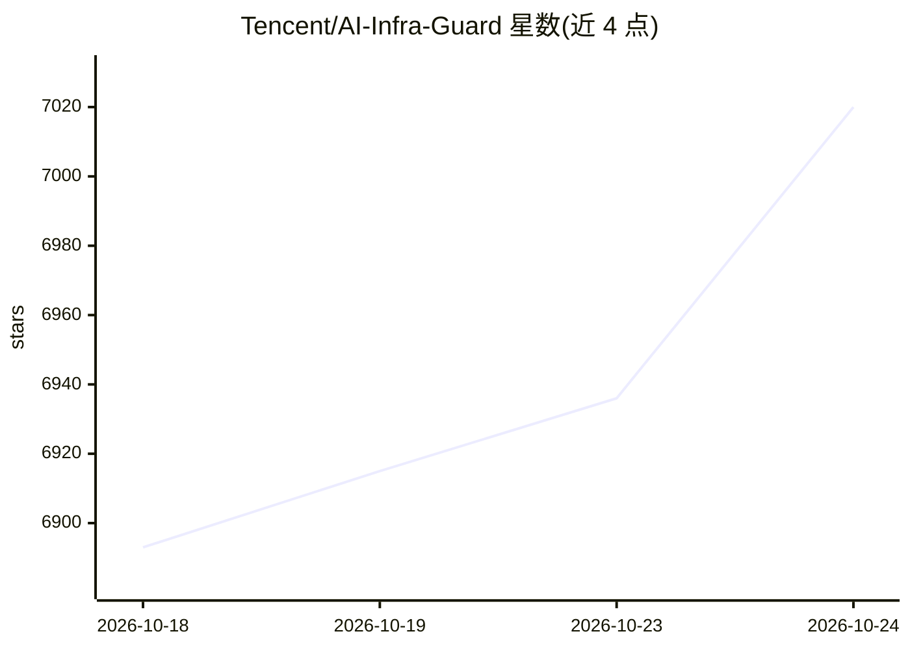

# Tencent/AI-Infra-Guard

⭐ 7,076 · Python · Apache-2.0 · 推送 2026-10-22 · [GitHub](https://github.com/Tencent/AI-Infra-Guard) · [官网](https://tencent.github.io/AI-Infra-Guard/) · 组织维护 · 中文 README

**面向企业/个人的 AI 红队安全平台：扫描 AI 基础设施与 Agent 风险**

腾讯朱雀实验室开发的全栈 AI 红队平台，功能包括 OpenClaw 安全扫描（ClawScan）、AI 基础设施漏洞扫描（覆盖 100+ 框架组件、2000+ CVE 规则，指纹识别 Ollama、vLLM、ComfyUI 等运行中服务）、MCP Server 与 Agent Skills 安全扫描（14 大类风险、支持源码与远程 URL）、多 Agent 工作流安全评估（支持 Dify/Coze 平台）、LLM 越狱评测（多攻击方法、跨模型对比）以及模型与 API 中转检测。提供 Web 界面与任务 API，以 Docker 部署为主，另有 pip 安装的 aig-skill-scan CLI 可集成 CI/CD。README 声明平台缺乏鉴权机制，不应部署在公共网络。

## 筛选速览

| 维度 | 判定 | 备注 |
|---|---|---|
| AI 角色 | `ai-ecosystem` | LLM/agent 周边工具 |
| 许可风险 | `permissive` | Apache-2.0 |
| 部署形态 | `self-host` | docker 或自建部署 |
| 模型依赖 | — | README 未给出锁定关系 |
| 硬件要求 | — | 无带数字的原话,不猜 |
| 安装摩擦 | `low` | 无编译、无系统依赖或容器化 |
| 成熟度 | — | 结构信号不足 |

## 能力要点

- AI 基础设施漏洞扫描：识别 100+ 组件、匹配 2000+ CVE
- MCP Server 与 Agent Skills 扫描：14 大类安全风险，支持源码/远程 URL
- LLM 越狱评测：多种攻击方法与跨模型对比
- Agent Scan 独立多 agent 自动化扫描框架，支持 Dify、Coze

## 适用场景

- 扫描内网运行的 vLLM/Ollama/ComfyUI 等 AI 服务的已知漏洞
- 审计 MCP Server 与 Agent Skills 的安全风险
- 对企业 LLM 做越狱攻击鲁棒性评测
- 将 aig-skill-scan 集成到 CI/CD 流水线做技能安全审计

## 场景标签

`网络安全` `模型评测` · 领域:评测与运维

## 证据(README 行号)

> L42:  A.I.G (AI-Infra-Guard) integrates capabilities such as ClawScan(OpenClaw Security Scan), Agent Scan，AI infra vulne
> L184: |**AI&nbsp;infra&nbsp;vulnerability&nbsp;scan**|This scanner precisely identifies over 100 AI framework components
> L185: |**Jailbreak&nbsp;Evaluation**|It assesses prompt security risks using carefully curated datasets. The evaluation 

## 星数曲线

2026-10-18 6,893 → 2026-10-24 7,020（+127）

---
*卡片 v1 · prompt 1.4 · 生成 2026-10-20 · 置信度 high · 依据 README sha `2267208c34c5` · [字段定义](../../DATASET.md)*
