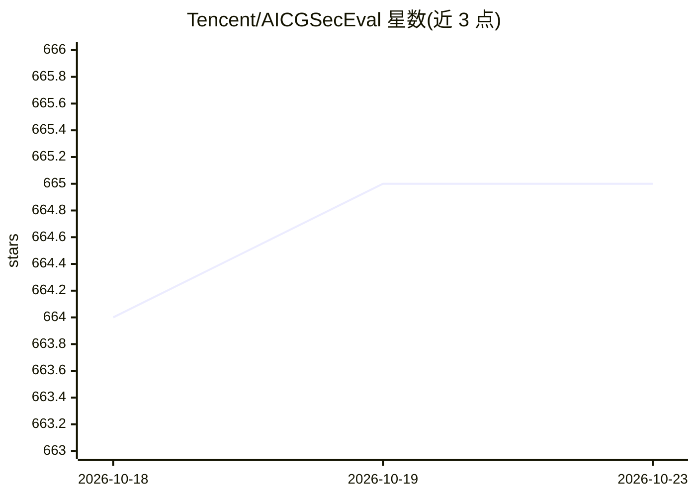

# Tencent/AICGSecEval

⭐ 665 · Python · NOASSERTION · 推送 2026-05-25 · [GitHub](https://github.com/Tencent/AICGSecEval) · [官网](https://aicgseceval.tencent.com) · 组织维护 · 中文 README

**腾讯团队维护的仓库级 AI 生成代码安全评测基准**

A.S.E (AICGSecEval) 提供项目级评测基准与框架，评估 AI 辅助编程生成代码的安全性：任务取自真实 GitHub 项目与 CVE 补丁，自动抽取项目级代码上下文模拟开发流程，采用静态+动态（测试用例与漏洞 PoC）混合评测。2.0 版覆盖 OWASP Top 10 与 CWE Top 25 相关的 29 类 CWE，支持 C/C++、PHP、Java、Python、JavaScript，并扩展支持 Agentic 编程工具评测。由腾讯安全平台部联合复旦、北大、上交、清华、浙大等高校开发，需 Python ≥3.11、内存 ≥16GB、磁盘 ≥100GB、Docker ≥27。

## 筛选速览

| 维度 | 判定 | 备注 |
|---|---|---|
| AI 角色 | `ai-knowledge` | 知识聚合/清单类 |
| 许可风险 | `none` | NOASSERTION |
| 部署形态 | `library` | 以包/库形式分发 |
| 模型依赖 | — | README 未给出锁定关系 |
| 硬件要求 | — | 无带数字的原话,不猜 |
| 安装摩擦 | `low` | 无编译、无系统依赖或容器化 |
| 成熟度 | — | 结构信号不足 |

## 能力要点

- 任务源自真实 GitHub 项目与权威 CVE 补丁，自动抽取项目级上下文
- 静态+动态混合评测：测试用例与漏洞 PoC 验证
- 覆盖 29 类 CWE（OWASP Top 10 / CWE Top 25 相关），含 5 类主流语言
- 支持 LLM 与 Agent 两类评测对象，提供断点续跑

## 适用场景

- 评测自家 LLM 或编程 Agent 生成代码的安全水平
- 安全研究人员开展 AI 生成代码安全实证研究
- 企业选型 AI 编程工具时参考安全性数据

## 场景标签

`模型评测` · 领域:评测与运维

## 证据(README 行号)

> L18: **A.S.E (AICGSecEval)** provides a **project-level benchmark for evaluating the security of AI-generated code**, de
> L53: 2️⃣ **Evaluation Target Upgrade – Support for Agentic Programming Tools**
> L56: 3️⃣ **Code Evaluation Upgrade – Static and Dynamic Hybrid Assessment**

## 星数曲线

2026-10-18 664 → 2026-10-23 665（+1）

---
*卡片 v1 · prompt 1.4 · 生成 2026-10-23 · 置信度 mid · 依据 README sha `8e24434cc48b` · [字段定义](../../DATASET.md)*
