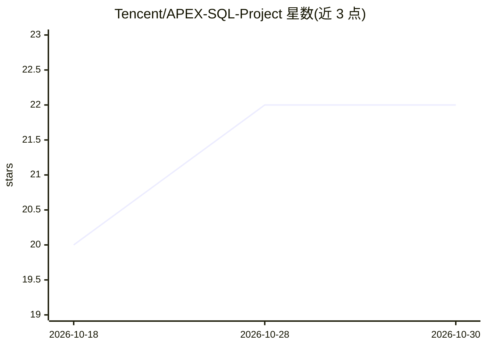

# Tencent/APEX-SQL-Project

⭐ 22 · Python · 推送 2026-05-18 · [GitHub](https://github.com/Tencent/APEX-SQL-Project) · 组织维护 · 中文 README

**Agentic Text-to-SQL 研究框架：假设-验证循环探索数据库生成 SQL**

腾讯发布的 agentic Text-to-SQL 框架，配套论文。核心为假设-验证（H-V）循环：agent 根据用户问题提出逻辑假设，通过在真实数据库上执行探索性 SQL 验证。分两阶段：Schema Linking（逻辑规划、双路剪枝、并行数据画像、全局综合）与 SQL 生成（宏计划聚合、确定性规则检索、agent 探索与自我纠错）。仓库含 BIRD（SQLite）与 Spider 2.0-Snow（Snowflake）两套基准实现，评测指标为 Execution Accuracy 与 Pass@K。

## 筛选速览

| 维度 | 判定 | 备注 |
|---|---|---|
| AI 角色 | `ai-native` | 本体是模型或模型工具 |
| 许可风险 | `none` | — |
| 部署形态 | `None` |  |
| 模型依赖 | — | README 未给出锁定关系 |
| 硬件要求 | — | 无带数字的原话,不猜 |
| 安装摩擦 | `low` | 无编译、无系统依赖或容器化 |
| 成熟度 | — | 结构信号不足 |

## 能力要点

- 假设-验证（H-V）循环将 Text-to-SQL 转为交互式推理任务
- 两阶段流程：agentic Schema Linking + SQL 生成
- 支持 BIRD（SQLite）与 Spider 2.0-Snow（Snowflake）两套基准
- 多候选采样：BIRD 用 reward model 选择，Spider 2.0-Snow 用结果多数投票

## 适用场景

- 在 BIRD/Spider 2.0 基准上复现 agentic Text-to-SQL 实验
- 研究者参考 H-V 循环机制构建自己的 Text-to-SQL agent
- 对企业级大规模模糊命名数据库做自然语言查询研究

## 场景标签

`数据分析` · 领域:效率与自动化

## 证据(README 行号)

> L3: **APEX-SQL** is an agentic Text-to-SQL framework that shifts the paradigm from *passive schema perception* to *agent
> L11: ├── BIRD/          # Implementation for the BIRD benchmark (SQLite)
> L12: └── Spider2/       # Implementation for the Spider 2.0-Snow benchmark (Snowflake)

## 星数曲线

2026-10-18 20 → 2026-10-30 22（+2）

---
*卡片 v1 · prompt 1.4 · 生成 2026-10-28 · 置信度 high · 依据 README sha `b047acb7e2a3` · [字段定义](../../DATASET.md)*
