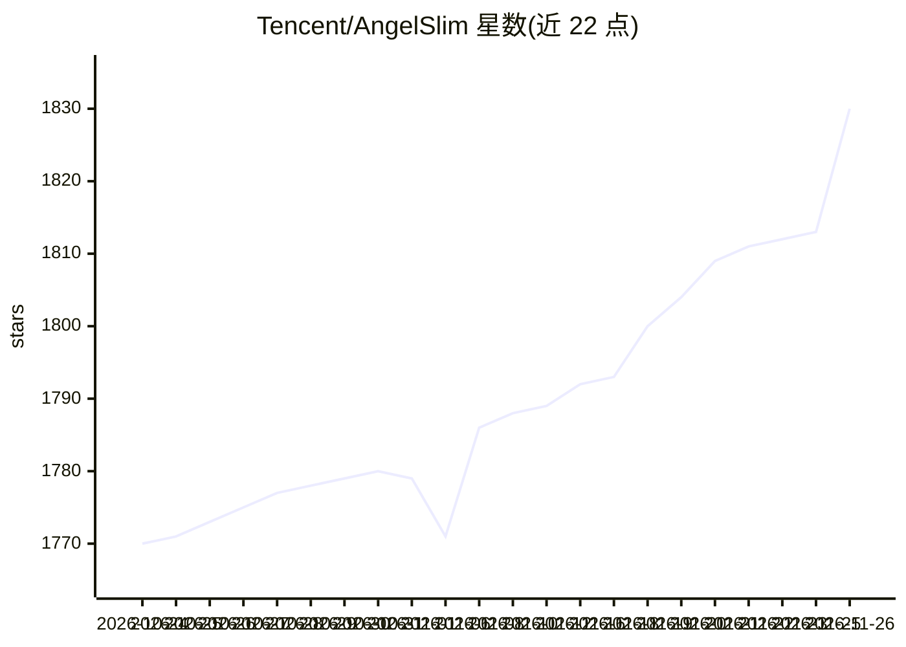

# Tencent/AngelSlim

⭐ 1,830 · Python · NOASSERTION · 推送 2026-11-25 · [GitHub](https://github.com/Tencent/AngelSlim) · [官网](https://angelslim.readthedocs.io) · 组织维护 · 中文 README

**面向开发者的大模型压缩工具包：量化/投机解码/蒸馏**

腾讯开源的大模型压缩工具链，将量化（FP8/INT4/NVFP4/低比特）、投机解码训练、稀疏注意力、蒸馏、缓存等主流压缩算法整合进统一框架，覆盖 LLM、VLM、Diffusion 与语音模型。以 pip 包与源码安装提供，通过配置文件或 Python Engine API 一键运行量化流程，并集成分裂式投机解码训练框架 AngelSpec（git submodule）支持多后端推理与多节点训练。

## 筛选速览

| 维度 | 判定 | 备注 |
|---|---|---|
| AI 角色 | `ai-ecosystem` | LLM/agent 周边工具 |
| 许可风险 | `none` | NOASSERTION |
| 部署形态 | `library` | 以包/库形式分发 |
| 模型依赖 | local-ok | 支持本地模型 |
| 硬件要求 | — | 无带数字的原话,不猜 |
| 安装摩擦 | `low` | 无编译、无系统依赖或容器化 |
| 成熟度 | — | 结构信号不足 |

## 能力要点

- 统一框架集成 FP8/INT4/NVFP4/MXFP4 等多种量化算法
- 支持 LLM/VLM/Diffusion/语音模型的压缩策略
- 集成分裂式投机解码训练框架 AngelSpec（DFly、MTP 等 draft 方法）
- vLLM/SGLang/HuggingFace 多后端推理与 Mooncake RDMA 多节点训练

## 适用场景

- 对 Qwen、DeepSeek、Hunyuan 等模型生成 FP8/INT4 量化权重
- 训练投机解码 draft 模型以加速推理
- 对 FLUX 等扩散模型做量化并在线推理验证
- 对 VLM 做视觉 token 剪枝与合并实验

## 场景标签

`模型量化` · 领域:训练与推理

## 证据(README 行号)

> L5: A more accessible, comprehensive, and efficient toolkit for large model compression.
> L44: - **Highly Integrated**: This toolkit integrates mainstream compression algorithms into a unified framework, offeri
> L193: - **Multi-backend inference** — vLLM (first-class), SGLang, and HuggingFace.

## 星数曲线

2026-10-24 1,770 → 2026-11-26 1,830（+60）

---
*卡片 v1 · prompt 1.4 · 生成 2026-11-26 · 置信度 high · 依据 README sha `152cd5fd7f73` · [字段定义](../../DATASET.md)*
