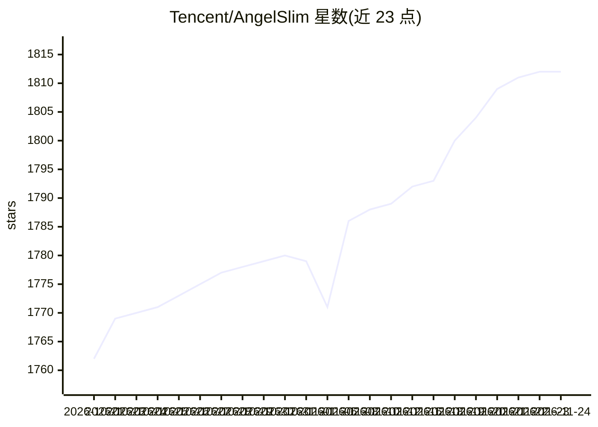

# Tencent/AngelSlim

⭐ 1,812 · Python · NOASSERTION · 推送 2026-11-20 · [GitHub](https://github.com/Tencent/AngelSlim) · [官网](https://angelslim.readthedocs.io) · 组织维护 · 中文 README

**面向开发者的大模型压缩工具包：量化与投机解码**

腾讯开源的模型压缩工具包，将量化（FP8/INT8/INT4/NVFP4 等）、投机解码训练（经子模块集成 AngelSpec）、稀疏注意力、蒸馏与缓存等压缩策略整合到统一框架。覆盖 LLM、VLM、扩散模型与语音模型，列出对 Hunyuan/Qwen/DeepSeek 等模型的支持矩阵。通过 pip 安装或源码安装，以 Python 命令行脚本与 Python Engine API 启动量化任务。

## 筛选速览

| 维度 | 判定 | 备注 |
|---|---|---|
| AI 角色 | `ai-ecosystem` | LLM/agent 周边工具 |
| 许可风险 | `none` | NOASSERTION |
| 部署形态 | `library` | 以包/库形式分发 |
| 模型依赖 | local-ok | 支持本地模型 |
| 硬件要求 | — | 无带数字的原话,不猜 |
| 安装摩擦 | `low` | 无编译、无系统依赖或容器化 |
| 成熟度 | — | 结构信号不足 |

## 能力要点

- 统一框架集成 FP8/INT4/NVFP4/TEQUILA 等多种量化算法
- 集成 AngelSpec 投机解码训练框架，支持 DFly/MTP 等草案方法
- 覆盖 LLM/VLM/扩散/语音四类模型的压缩策略矩阵
- 单 GPU 量化大模型的流程（如 Qwen3-235B、DeepSeek-R1）

## 适用场景

- 对本地或 HuggingFace 上的 LLM 做 FP8/INT4 离线量化
- 训练投机解码草案模型以加速推理
- 量化扩散模型并直接在线推理验证效果

## 场景标签

`模型量化` · 领域:训练与推理

## 证据(README 行号)

> L5: A more accessible, comprehensive, and efficient toolkit for large model compression.
> L44: - **Highly Integrated**: This toolkit integrates mainstream compression algorithms into a unified framework, offeri
> L157: ## 🛎️How to Use

## 星数曲线

2026-10-21 1,762 → 2026-11-24 1,812（+50）

---
*卡片 v1 · prompt 1.4 · 生成 2026-11-23 · 置信度 high · 依据 README sha `b046032080f5` · [字段定义](../../DATASET.md)*
