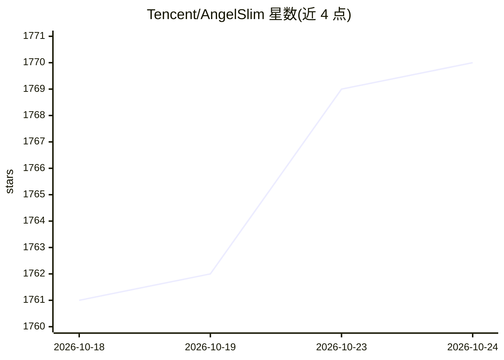

# Tencent/AngelSlim

⭐ 1,771 · Python · NOASSERTION · 推送 2026-10-14 · [GitHub](https://github.com/Tencent/AngelSlim) · [官网](https://angelslim.readthedocs.io) · 组织维护 · 中文 README

**腾讯开源的大模型压缩工具包：量化、蒸馏、投机解码、稀疏注意力**

面向开发者的统一模型压缩工具包，将主流压缩算法集成到单一框架中：支持 LLM/VLM/语音/扩散模型的 FP8/INT8/INT4/NVFP4/1.25-bit 等量化（PTQ、QAD、QAT 蒸馏）、Eagle3/MTP/DFly/DFlare 等投机解码训练（经 AngelSpec 子模块）、稀疏注意力与视觉 token 剪枝，覆盖 Hunyuan、Qwen、DeepSeek、GLM、FLUX 等模型系列。通过 pip 安装，提供一键脚本与 Python Engine API，量化产物可经 vLLM/SGLang 部署 OpenAI 兼容 API。由腾讯团队维护并持续开源算法与模型权重。

## 筛选速览

| 维度 | 判定 | 备注 |
|---|---|---|
| AI 角色 | `ai-ecosystem` | LLM/agent 周边工具 |
| 许可风险 | `none` | NOASSERTION |
| 部署形态 | `library` | 以包/库形式分发 |
| 模型依赖 | local-ok | 支持本地模型 |
| 硬件要求 | — | 无带数字的原话,不猜 |
| 安装摩擦 | `low` | 无编译、无系统依赖或容器化 |
| 成熟度 | — | 结构信号不足 |

## 能力要点

- 统一框架集成量化、蒸馏、投机解码、稀疏注意力、token 剪枝等压缩技术
- 支持 LLM/VLM/语音/扩散四类模型，覆盖 Hunyuan/Qwen/DeepSeek/GLM/FLUX 等系列
- AngelSpec 投机解码训练框架以 git 子模块提供，支持 vLLM/SGLang/HF 多后端
- 量化模型可经 vLLM/SGLang 部署 OpenAI 兼容 API 服务

## 适用场景

- 对 Qwen/DeepSeek 等大模型做 FP8/INT4 量化以降低部署成本
- 训练 Eagle3/MTP 等投机解码草稿模型加速推理
- 压缩 FLUX/SDXL 等扩散模型并在线推理
- 对 VLM 做视觉 token 剪枝以压缩上下文

## 场景标签

`模型量化` `微调` · 领域:训练与推理

## 证据(README 行号)

> L5: A more accessible, comprehensive, and efficient toolkit for large model compression.
> L39: - **Highly Integrated**: This toolkit integrates mainstream compression algorithms into a unified framework, offeri
> L41: - **Performance-Driven**: We continuously optimize end-to-end performance in model compression workflows and algori

## 星数曲线

2026-10-18 1,761 → 2026-10-24 1,770（+9）

---
*卡片 v1 · prompt 1.4 · 生成 2026-10-21 · 置信度 high · 依据 README sha `9c197efbf951` · [字段定义](../../DATASET.md)*
