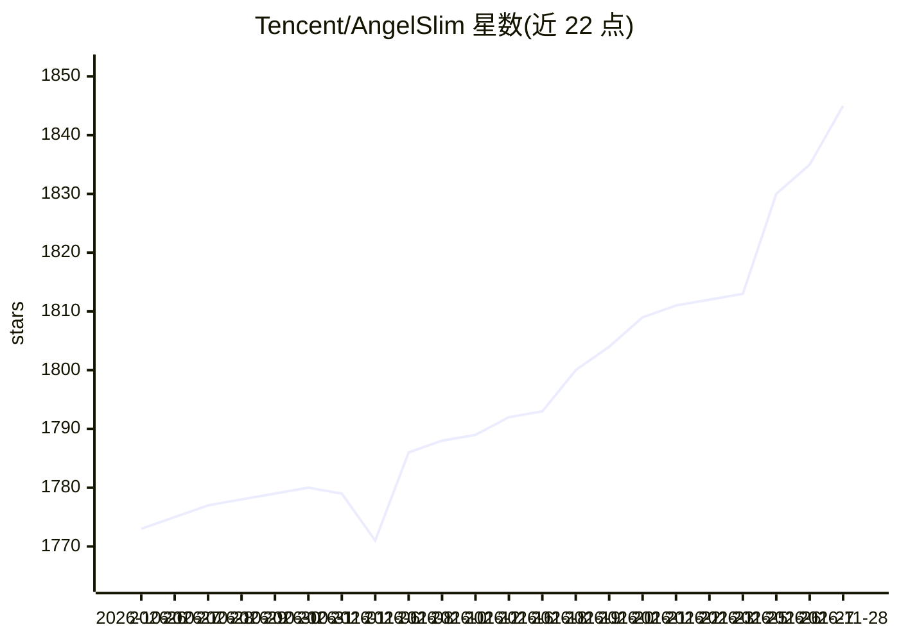

# Tencent/AngelSlim

⭐ 1,845 · Python · NOASSERTION · 推送 2026-11-27 · [GitHub](https://github.com/Tencent/AngelSlim) · [官网](https://angelslim.readthedocs.io) · 组织维护 · 中文 README

**大模型压缩工具包：量化/投机解码/蒸馏/稀疏注意力**

腾讯开源的大模型压缩工具包，将量化、投机解码、蒸馏、稀疏注意力与缓存等主流压缩算法整合进统一框架，覆盖 LLM、VLM、扩散模型与语音（TTS/ASR）模型，支持 Hunyuan、Qwen、DeepSeek、FLUX 等系列模型的 FP8/INT4/低比特量化输出。以 pip 包与源码方式安装，通过 YAML 配置脚本或 Python Engine API 运行；投机解码训练由 git 子模块引入的 AngelSpec 框架承担，支持 vLLM/SGLang/HuggingFace 多后端推理与分离式训练架构。

## 筛选速览

| 维度 | 判定 | 备注 |
|---|---|---|
| AI 角色 | `ai-ecosystem` | LLM/agent 周边工具 |
| 许可风险 | `none` | NOASSERTION |
| 部署形态 | `library` | 以包/库形式分发 |
| 模型依赖 | local-ok | 支持本地模型 |
| 硬件要求 | — | 无带数字的原话,不猜 |
| 安装摩擦 | `low` | 无编译、无系统依赖或容器化 |
| 成熟度 | — | 结构信号不足 |

## 能力要点

- 统一框架集成量化、投机解码、蒸馏、稀疏注意力、Cache 等压缩技术
- 覆盖 LLM/VLM/扩散/语音四类模型的压缩策略表
- 投机解码训练框架 AngelSpec 支持 vLLM、SGLang、HuggingFace 多后端
- 输出 FP8/INT4/GGUF 等量化权重并提供部署补丁（如 llama.cpp patch）

## 适用场景

- 对 Qwen/Hunyuan/DeepSeek 等模型做 FP8 或低比特量化后部署
- 训练并接入投机解码 draft 模型以加速推理
- 对扩散模型做量化与 Cache 加速
- 为长上下文推理选择稀疏注意力与 prefill 加速方案

## 场景标签

`模型量化` `模型训练` · 领域:训练与推理

## 证据(README 行号)

> L5: A more accessible, comprehensive, and efficient toolkit for large model compression.
> L46: - **Highly Integrated**: This toolkit integrates mainstream compression algorithms into a unified framework, offeri
> L196: - **Multi-backend inference** — vLLM, SGLang and HuggingFace.

## 星数曲线

2026-10-26 1,773 → 2026-11-28 1,845（+72）

---
*卡片 v1 · prompt 1.4 · 生成 2026-11-27 · 置信度 high · 依据 README sha `8c5a25f5c1cc` · [字段定义](../../DATASET.md)*
