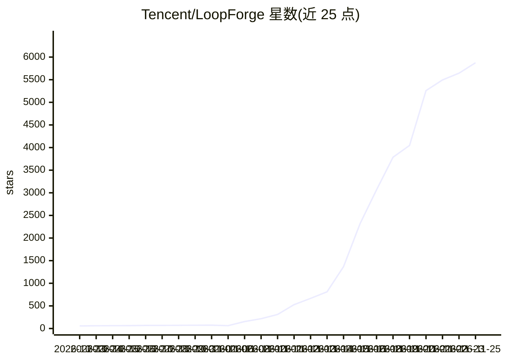

# Tencent/LoopForge

⭐ 5,874 · Go · NOASSERTION · 推送 2026-11-23 · [GitHub](https://github.com/Tencent/LoopForge) · [官网](https://loopforge.cn) · 组织维护 · 中文 README

**自托管工作台：团队用编码代理走可复用 SOP 交付代码**

自托管的多代理编码交付平台：通过 Main Bot 在 Docker 沙箱中与仓库交互并开出 PR，或将验证过的工作方式固化为 SOP（Agent、Script、Human-gate 与子 SOP 节点按序执行）。角色分离规划、实现、审查、测试，人工审批门可回退或重试任一节点。以 Compose 部署 GHCR 镜像运行，含 MySQL；无 API key 时可运行纯脚本+审批的演示项目。沙箱经宿主 Docker socket 启动，文档声明面向可信团队而非多租户隔离。

## 筛选速览

| 维度 | 判定 | 备注 |
|---|---|---|
| AI 角色 | `ai-ecosystem` | LLM/agent 周边工具 |
| 许可风险 | `none` | NOASSERTION |
| 部署形态 | `self-host` | docker 或自建部署 |
| 模型依赖 | — | README 未给出锁定关系 |
| 硬件要求 | — | 无带数字的原话,不猜 |
| 安装摩擦 | `low` | 无编译、无系统依赖或容器化 |
| 成熟度 | — | 结构信号不足 |

## 能力要点

- 两条工作路径：聊天驱动 Main Bot 与固定阶段的 SOP 引擎
- 十个编码代理 CLI 作为执行器（CodeBuddy/Codex/Claude Code/OpenCode/Cursor CLI 等）
- 人工审批门：暂停、接管、退回指定步骤或从任一节点重跑
- 需求追踪、成本报告与节点级日志/工件记录

## 适用场景

- 团队把 bug 修复、前后端开发固化为可重复的 SOP 流程
- 让编码代理在沙箱里改仓库代码并自动开 PR，人工审批后合并
- 无 API key 时先跑脚本+审批的演示项目了解流程

## 场景标签

`编码 Agent` `多智能体` `工作流自动化` `代码审查` · 领域:Agent 开发

## 证据(README 行号)

> L24: **LoopForge** is a self-hosted workspace where your team ships software with coding agents. Describe what you need 
> L26: Coding-agent CLIs do the work: CodeBuddy, Codex, Claude Code, OpenCode, Cursor CLI, Antigravity, Kimi Code, Pi, Dee
> L33: |How it runs|Main Bot opens a conversation workspace (a Docker sandbox with your repos) on demand and calls project

## 星数曲线

2026-10-23 57 → 2026-11-25 5,874（+5,817）

---
*卡片 v1 · prompt 1.4 · 生成 2026-11-23 · 置信度 high · 依据 README sha `4be7a2b9fdaf` · [字段定义](../../DATASET.md)*
