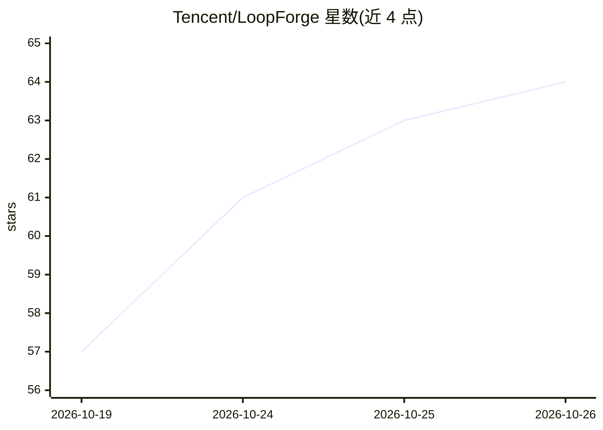

# Tencent/LoopForge

⭐ 64 · Go · NOASSERTION · 推送 2026-10-20 · [GitHub](https://github.com/Tencent/LoopForge) · [官网](https://loopforge.cn) · 组织维护 · 中文 README

**自托管平台：将编码 Agent、脚本与人工审批编排为交付工作流**

腾讯开源的自托管交付工作流平台：把 CodeBuddy、Codex、Claude Code 等编码 Agent 与确定性脚本、人工审批门组合成 SOP，在可视化画布上编排 Agent/Script/Human gate/子 SOP 节点，内置后端、前端、修 Bug 与产品类 SOP。支持 Docker 沙箱、GitHub 集成、运行证据与指标分析。另提供 LoopForge Local，经 npm CLI 将内置工作流装入 Claude Code、Cursor 等编码助手中。平台版需 Docker + Python 3，Local 版需 Node.js 20+ 与编码助手。默认部署面向可信团队，模型凭据自带。

## 筛选速览

| 维度 | 判定 | 备注 |
|---|---|---|
| AI 角色 | `ai-ecosystem` | LLM/agent 周边工具 |
| 许可风险 | `none` | NOASSERTION |
| 部署形态 | `library` | 以包/库形式分发 |
| 模型依赖 | — | README 未给出锁定关系 |
| 硬件要求 | — | 无带数字的原话,不猜 |
| 安装摩擦 | `low` | 无编译、无系统依赖或容器化 |
| 成熟度 | — | 结构信号不足 |

## 能力要点

- SOP 可视化设计器：Agent/Script/Human gate/子 SOP 节点与版本发布
- CodeBuddy、Codex、Claude Code 三种执行器，角色可独立选择
- 人工审批门、节点状态/工具轨迹/日志与产物快照，支持暂停与从任意节点重跑
- LoopForge Local 经 npx 将内置工作流装入 Claude Code/Codex/Cursor 等助手

## 适用场景

- 团队把'计划→实现→独立评审→测试→人工签收'固化为可复用流程
- 在 IDE/CLI 内单人使用内置交付工作流
- 为编码 Agent 交付接入 GitHub 仓库、沙箱与审批留痕

## 场景标签

`多智能体` `工作流自动化` `代码审查` · 领域:Agent 开发

## 证据(README 行号)

> L31: **LoopForge** is a self-hosted platform that puts **coding agents, deterministic scripts and human decisions into o
> L45: - **Bring your own stack** — CodeBuddy, Codex and Claude Code as executors; GitHub, Skills and MCP as tools; Docker

## 星数曲线

2026-10-19 57 → 2026-10-26 64（+7）

---
*卡片 v1 · prompt 1.4 · 生成 2026-10-24 · 置信度 high · 依据 README sha `4ae0e66d6b13` · [字段定义](../../DATASET.md)*
