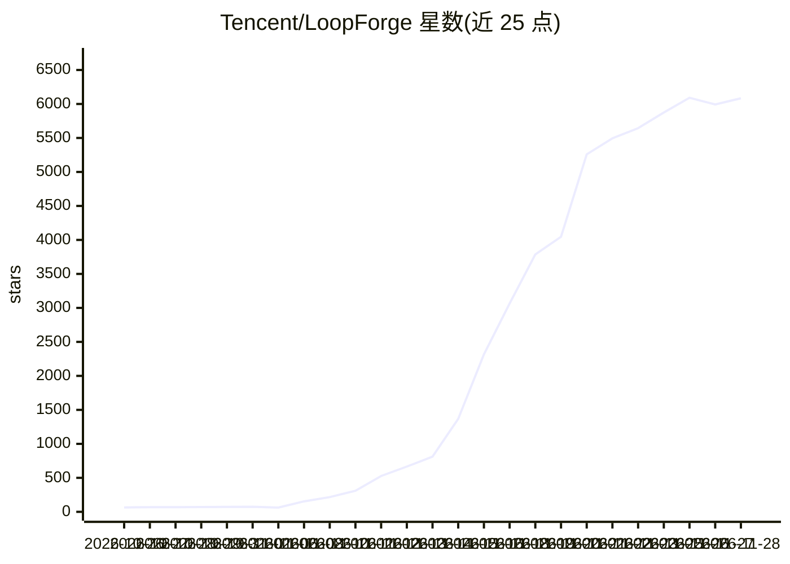

# Tencent/LoopForge

⭐ 6,084 · Go · NOASSERTION · 推送 2026-11-27 · [GitHub](https://github.com/Tencent/LoopForge) · [官网](https://loopforge.cn) · 组织维护 · 中文 README

**自托管平台：编排编码 agent 完成需求交付并设人工审批门**

LoopForge 是腾讯开源的自托管编码 agent 交付工作台。团队在聊天中向 Main Bot 描述需求，平台在 Docker 沙箱中检出仓库、委派项目角色并提交 PR；成熟的工作方式可保存为 LOOP（由 Agent、Script、Human-gate 节点组成的可复用交付流程）。支持 CodeBuddy、Codex、Claude Code 等十个编码 agent CLI 作为执行器，提供节点状态、日志、制品的追踪与失败重试。部署依赖 Docker/Compose，服务默认监听 8090 端口，面向可信团队环境。

## 筛选速览

| 维度 | 判定 | 备注 |
|---|---|---|
| AI 角色 | `ai-ecosystem` | LLM/agent 周边工具 |
| 许可风险 | `none` | NOASSERTION |
| 部署形态 | `self-host` | docker 或自建部署 |
| 模型依赖 | — | README 未给出锁定关系 |
| 硬件要求 | — | 无带数字的原话,不猜 |
| 安装摩擦 | `low` | 无编译、无系统依赖或容器化 |
| 成熟度 | — | 结构信号不足 |

## 能力要点

- LOOP 工作流引擎：Agent、Script、Human-gate、子 LOOP 节点按序运行，可回退到任意步骤
- 人工审批门：暂停、转向、接管运行中的任务，在关键节点等待人工决定
- 十个编码 agent CLI 作为执行器（CodeBuddy 默认内置，其余按需安装）
- Docker 沙箱隔离运行，需求追溯与成本报告，GitHub/GitLab/Gitea 等托管对接

## 适用场景

- 团队用编码 agent 交付需求，并在合并前设置人工审批
- 把固定的开发流程（规划-实现-审查-测试-验收）固化为可复用 LOOP
- 在自建服务器上统一管理多个编码 agent 的运行与凭证
- 通过企业微信接收任务通知与审批提醒

## 场景标签

`编码 Agent` `多智能体` · 领域:Agent 开发

## 证据(README 行号)

> L24: **LoopForge** is a self-hosted workspace where your team ships software with coding agents. Describe what you need 
> L26: Coding-agent CLIs do the work: CodeBuddy, Codex, Claude Code, OpenCode, Cursor CLI, Antigravity, Kimi Code, Pi, Dee
> L51: - **Your stack, your servers.** Ten coding-agent CLIs as executors, from CodeBuddy, Codex and Claude Code to OpenCo

## 星数曲线

2026-10-26 64 → 2026-11-28 6,084（+6,020）

---
*卡片 v1 · prompt 1.4 · 生成 2026-11-27 · 置信度 high · 依据 README sha `22c66d8f801d` · [字段定义](../../DATASET.md)*
