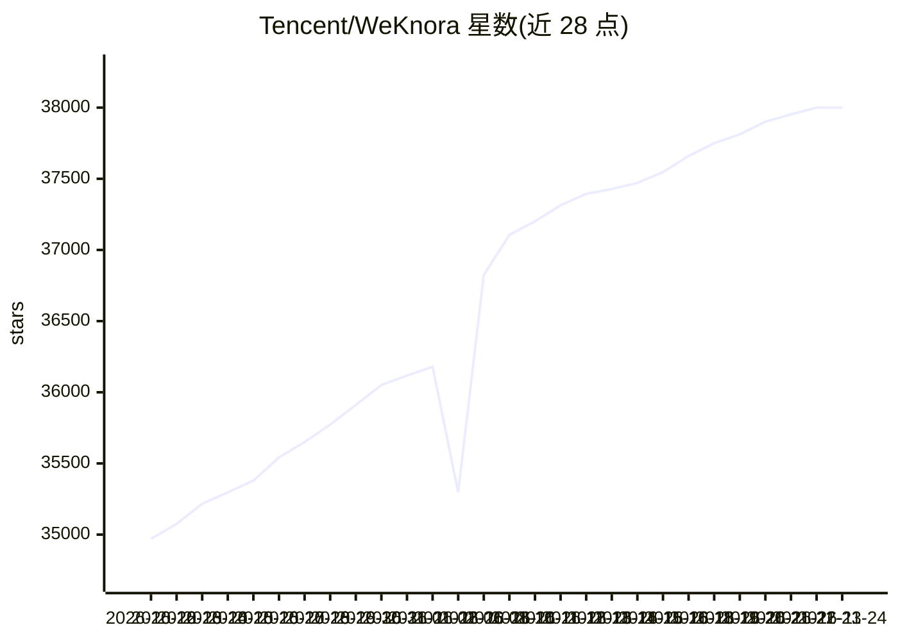

# Tencent/WeKnora

⭐ 38,087 · Go · NOASSERTION · 推送 2026-11-23 · [GitHub](https://github.com/Tencent/WeKnora) · [官网](https://weknora.weixin.qq.com) · 组织维护 · 中文 README

**企业知识库 RAG 平台：文档检索问答、推理 agent 与知识 Wiki**

面向企业的开源 LLM 知识框架，将团队文档整合为可检索、可推理、可持续更新的知识库。提供三种工作模式：带混合检索、多模态解析与引用溯源的 RAG 问答；支持多步推理、技能沙箱、本地浏览器与 MCP 工具的 agent；以及带知识图谱与回滚的 Wiki。数据源支持飞书、Confluence、Notion 等自动同步，30+ 内置模型厂商可配置，多工作区 RBAC 与审计日志，Docker Compose/Kubernetes/单二进制/桌面应用多种部署方式。

## 筛选速览

| 维度 | 判定 | 备注 |
|---|---|---|
| AI 角色 | `ai-native` | 本体是模型或模型工具 |
| 许可风险 | `none` | NOASSERTION |
| 部署形态 | `self-host` | docker 或自建部署 |
| 模型依赖 | local-ok | 支持本地模型 |
| 硬件要求 | — | 无带数字的原话,不猜 |
| 安装摩擦 | `low` | 无编译、无系统依赖或容器化 |
| 成熟度 | — | 结构信号不足 |

## 动量与使用信号

- 维护:`active` — 距上次 push 0.7 天,年发版 38,254 位贡献者
- 涨星:近 1 天 **+175**(自 20261016 起算)
- 平台:— · 协议:OPENAI-API / MCP / OLLAMA

## 能力要点

- RAG/Agent/Wiki 三种模式共享同一知识库
- 技能沙箱支持 Docker/E2B/Cube，agent 可经 BrowserSkill 操作本地 Chrome/Edge
- 30 内置模型厂商目录，LLM、向量库与存储后端均可替换
- 多工作区 RBAC、审计日志与 Langfuse 追踪

## 适用场景

- 把团队文档变成可引用溯源的问答知识库
- 让 agent 执行多步知识任务并接入 MCP 工具
- 将文档自动组织为带知识图谱的 Wiki
- 在私有环境部署并接入企业 IM 做问答

## 场景标签

`RAG` `文档问答` `知识库管理` · 领域:知识与检索

## 证据(README 行号)

> L32: WeKnora is an open-source, LLM-powered knowledge framework for enterprise document understanding, semantic retrieva
> L40:  01 RAG: answers you can check, with hybrid search, multimodal parsing and citations. 02 Agent: tasks done with kno
> L49: - **Models**: 30 built-in vendors with a generated model catalog, including OpenAI, DeepSeek, Qwen (Alibaba Cloud),

## 星数曲线

2026-10-22 34,971 → 2026-11-24 38,000（+3,029）

---
*卡片 v1 · prompt 1.4 · 生成 2026-11-22 · 置信度 high · 依据 README sha `03182a3dbc66` · [字段定义](../../DATASET.md)*
