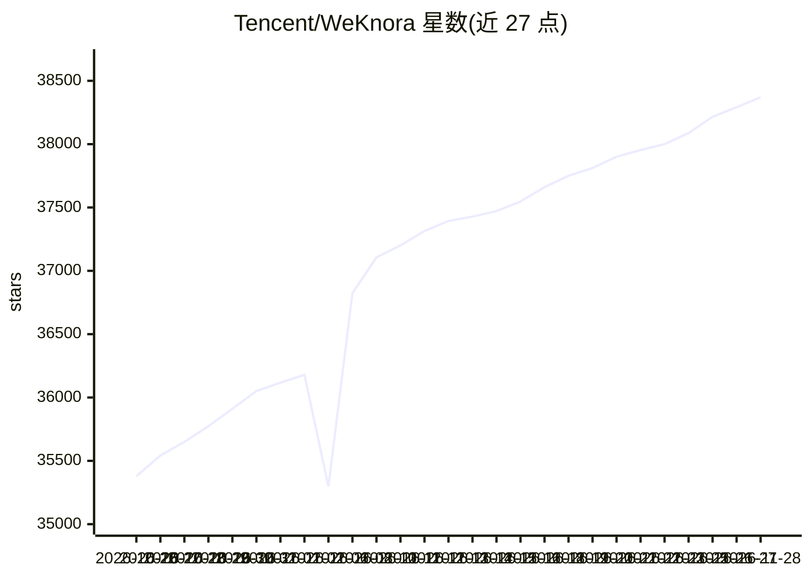

# Tencent/WeKnora

⭐ 38,370 · Go · NOASSERTION · 推送 2026-11-27 · [GitHub](https://github.com/Tencent/WeKnora) · [官网](https://weknora.weixin.qq.com) · 组织维护 · 中文 README

**面向企业的开源 LLM 知识库平台：RAG、Agent 与 Wiki 三合一**

腾讯开源的 LLM 知识框架，将团队文档转为可检索、可推理的知识库，提供 RAG 问答、多步推理 Agent 与知识 Wiki 三种模式，共享同一知识库。技术栈为 Go 后端加 Web UI，支持混合检索、多模态解析与答案引用；Agent 技能在 Docker/E2B/Cube 沙箱运行，可接入 MCP 工具与本地浏览器。部署支持 Docker Compose、Kubernetes Helm、Lite 单二进制与桌面应用（需源码构建）。限制方面：生产环境建议内网部署，桌面应用暂无安装包，旧版升级需阅读升级说明。

## 筛选速览

| 维度 | 判定 | 备注 |
|---|---|---|
| AI 角色 | `ai-native` | 本体是模型或模型工具 |
| 许可风险 | `none` | NOASSERTION |
| 部署形态 | `self-host` | docker 或自建部署 |
| 模型依赖 | local-ok | 支持本地模型 |
| 硬件要求 | — | 无带数字的原话,不猜 |
| 安装摩擦 | `low` | 无编译、无系统依赖或容器化 |
| 成熟度 | — | 结构信号不足 |

## 动量与使用信号

- 维护:`active` — 距上次 push 0.7 天,年发版 38,254 位贡献者
- 涨星:近 1 天 **+175**(自 20261016 起算)
- 平台:— · 协议:OPENAI-API / MCP / OLLAMA

## 能力要点

- RAG 混合检索、多模态解析与可溯源引用
- Agent 支持多步推理、技能沙箱（Docker/E2B/Cube）、本地浏览器控制与 MCP 工具
- 31 家内置模型厂商目录，含 OpenAI、DeepSeek、Qwen、Ollama 等，可替换
- 多工作区 RBAC、跨会话长期记忆与 Langfuse 追踪

## 适用场景

- 把团队文档建成可检索问答的知识库
- 让 Agent 在沙箱中执行多步知识任务
- 将文档自动整理为带知识图谱的 Wiki
- 私有化部署并接入企业微信/飞书等 IM 做问答

## 场景标签

`RAG` `聊天机器人` `文档问答` · 领域:对话与助手

## 证据(README 行号)

> L32: WeKnora is an open-source, LLM-powered knowledge framework for enterprise document understanding, semantic retrieva
> L38: Use RAG to look things up, the agent for multi-step tasks, and the wiki to organize knowledge. All three work on th
> L42: **The agent's toolbox.** Skills installed from ClawHub / SkillHub / Git / ZIP run in session-persistent Docker / E2

## 星数曲线

2026-10-26 35,379 → 2026-11-28 38,370（+2,991）

---
*卡片 v1 · prompt 1.4 · 生成 2026-11-28 · 置信度 high · 依据 README sha `dbf3133fbb93` · [字段定义](../../DATASET.md)*
