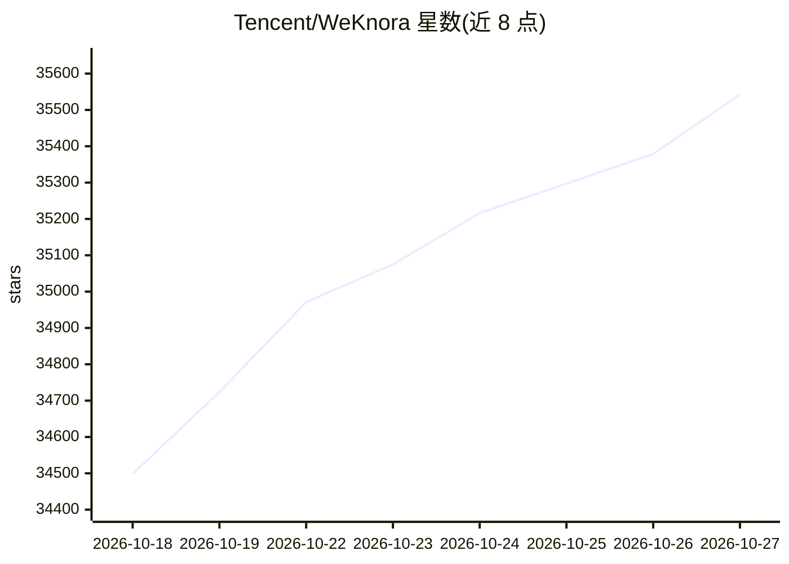

# Tencent/WeKnora

⭐ 35,542 · Go · NOASSERTION · 推送 2026-10-26 · [GitHub](https://github.com/Tencent/WeKnora) · [官网](https://weknora.weixin.qq.com) · 组织维护 · 中文 README

**面向企业的开源 LLM 知识平台：文档转 RAG、Agent 与 Wiki**

腾讯开源的 LLM 知识框架，围绕同一知识库提供三种模式：RAG（混合检索、多模态解析、引用溯源）、Agent（多步推理、技能沙箱、本地浏览器、MCP 工具与记忆）、Wiki（知识图谱组织与回滚）。支持飞书、Confluence、Notion 等 10 余种数据源自动同步与 10+ 文档格式解析；内置 29 家模型供应商；多工作区 RBAC、任务队列治理与 Langfuse 追踪。可通过 Docker Compose、Kubernetes Helm、Lite 单二进制或桌面应用部署，数据可留在自有环境。

## 筛选速览

| 维度 | 判定 | 备注 |
|---|---|---|
| AI 角色 | `ai-native` | 本体是模型或模型工具 |
| 许可风险 | `none` | NOASSERTION |
| 部署形态 | `self-host` | docker 或自建部署 |
| 模型依赖 | local-ok | 支持本地模型 |
| 硬件要求 | — | 无带数字的原话,不猜 |
| 安装摩擦 | `low` | 无编译、无系统依赖或容器化 |
| 成熟度 | — | 结构信号不足 |

## 动量与使用信号

- 维护:`active` — 距上次 push 0.7 天,年发版 38,254 位贡献者
- 涨星:近 1 天 **+175**(自 20261016 起算)
- 平台:— · 协议:OPENAI-API / MCP / OLLAMA

## 能力要点

- RAG、Agent、Wiki 三模式共享同一知识库
- 技能经 ClawHub/Git/ZIP 安装并在 Docker/E2B/Cube 沙箱运行，支持操作本地 Chrome/Edge
- 29 家内置模型供应商目录，含 OpenAI、DeepSeek、Ollama 等，模型/向量库/存储后端可替换
- 飞书、Confluence、GitLab、Notion 等数据源自动同步，10+ 文档格式解析

## 适用场景

- 把团队文档搭建成可引用溯源的企业问答系统
- 用 Agent 沙箱执行基于知识库的多步任务
- 将文档组织为带知识图谱的内部 Wiki
- 通过企业微信、飞书、Slack 等 IM 渠道接入问答

## 场景标签

`RAG` `文档问答` `知识图谱` · 领域:知识与检索

## 证据(README 行号)

> L32: WeKnora is an open-source, LLM-powered knowledge framework for enterprise document understanding, semantic retrieva
> L40:  01 RAG: answers you can check, with hybrid search, multimodal parsing and citations. 02 Agent: tasks done with kno
> L49: - **Models**: 29 built-in vendors with a generated model catalog, including OpenAI, DeepSeek, Qwen (Alibaba Cloud),

## 星数曲线

2026-10-18 34,498 → 2026-10-27 35,542（+1,044）

---
*卡片 v1 · prompt 1.4 · 生成 2026-10-18 · 置信度 high · 依据 README sha `15d496c87e81` · [字段定义](../../DATASET.md)*
