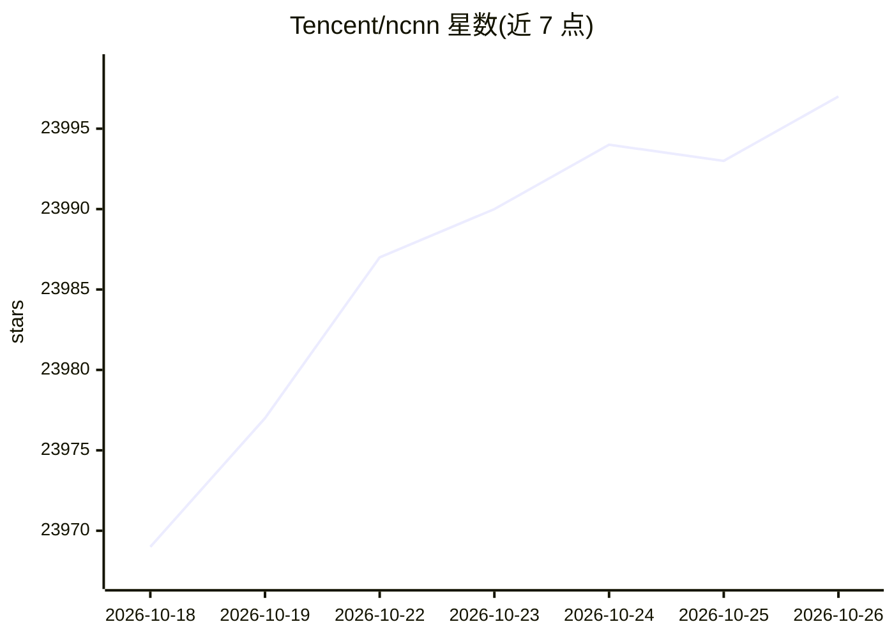

# Tencent/ncnn

⭐ 23,997 · C++ · NOASSERTION · 推送 2026-10-25 · [GitHub](https://github.com/Tencent/ncnn) · 组织维护 · 中文 README

**面向移动/嵌入式/桌面端部署的神经网络推理框架**

ncnn 是腾讯开源的神经网络推理框架，无第三方运行时依赖，支持 CPU 与 Vulkan GPU 后端，提供 C++ API 与 Python 绑定。通过 pnnx 工具将 PyTorch 和 ONNX 模型转换为 ncnn 格式，并保留 Caffe/MXNet/Darknet 等旧格式转换器。支持 int8 量化、fp16 计算、自定义层与模型优化工具。提供覆盖 Android、iOS、Windows、Linux、WebAssembly 等平台的预编译包，也可从源码构建。已在 QQ、微信等腾讯应用中使用，覆盖分类、检测、分割、OCR 等模型类型。

## 筛选速览

| 维度 | 判定 | 备注 |
|---|---|---|
| AI 角色 | `ai-ecosystem` | LLM/agent 周边工具 |
| 许可风险 | `none` | NOASSERTION |
| 部署形态 | `library` | 以包/库形式分发 |
| 模型依赖 | — | README 未给出锁定关系 |
| 硬件要求 | — | 无带数字的原话,不猜 |
| 安装摩擦 | `medium` | 含编译或系统依赖之一 |
| 成熟度 | — | 结构信号不足 |

## 动量与使用信号

- 维护:`active` — 距上次 push 0.7 天,年发版 2,374 位贡献者
- 涨星:近 1 天 **+6**(自 20261016 起算)
- 安装:pypi 包 `pnnx` 月下载 85,389
- 平台:WINDOWS / MACOS / LINUX / ANDROID / IOS · 协议:—

## 能力要点

- 无第三方运行时依赖，纯 C++ 实现，提供 C API 与 Python 绑定
- CPU（ARM NEON、多核调度）与 Vulkan GPU 两种推理后端
- pnnx 工具完成 PyTorch/ONNX 模型转换，支持 int8 量化与 fp16
- 提供 Android/iOS/WebAssembly/HarmonyOS 等多平台预编译包与构建指南

## 适用场景

- 在手机 App 中离线部署视觉模型（分类、检测、人脸、OCR）
- 在树莓派、Jetson 等嵌入式设备上运行推理
- 将 PyTorch 训练的模型转换为移动端可运行格式

## 场景标签

`推理引擎` · 领域:训练与推理

## 证据(README 行号)

> L9: ncnn is a high-performance neural network inference framework optimized for mobile, embedded, and desktop deployment
> L10: It has no third-party runtime dependencies, runs across CPU and Vulkan GPU backends, and provides tools such as pnn
> L181: - Optimized CPU inference for mobile and embedded processors, including ARM NEON and multi-core scheduling.

## 星数曲线

2026-10-18 23,969 → 2026-10-26 23,997（+28）

---
*卡片 v1 · prompt 1.4 · 生成 2026-10-18 · 置信度 high · 依据 README sha `9ffd38ce0c73` · [字段定义](../../DATASET.md)*
