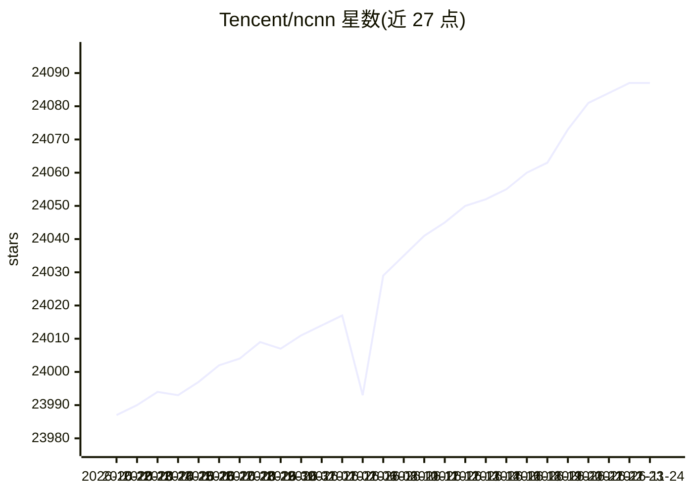

# Tencent/ncnn

⭐ 24,087 · C++ · NOASSERTION · 推送 2026-11-21 · [GitHub](https://github.com/Tencent/ncnn) · 组织维护 · 中文 README

**面向移动/嵌入式/桌面部署的神经网络推理框架**

腾讯开源的神经网络推理框架，针对移动端、嵌入式和桌面端部署优化。无第三方运行时依赖，支持 CPU（含 ARM NEON 优化与多核调度）与 Vulkan GPU 后端，提供 pnnx 工具将 PyTorch 和 ONNX 模型转换为 ncnn 格式，并保留 Caffe/MXNet/Darknet 旧格式兼容转换器。纯 C++ 实现，带 C API 和 Python 绑定，支持 fp16、int8 量化推理与自定义层。已在 QQ、微信、天天 P 图等腾讯应用中使用；覆盖 Android/iOS/macOS/Linux/Windows/WebAssembly/HarmonyOS 等多平台构建指南。

## 筛选速览

| 维度 | 判定 | 备注 |
|---|---|---|
| AI 角色 | `ai-native` | 本体是模型或模型工具 |
| 许可风险 | `none` | NOASSERTION |
| 部署形态 | `library` | 以包/库形式分发 |
| 模型依赖 | — | README 未给出锁定关系 |
| 硬件要求 | — | 无带数字的原话,不猜 |
| 安装摩擦 | `medium` | 含编译或系统依赖之一 |
| 成熟度 | — | 结构信号不足 |

## 动量与使用信号

- 维护:`active` — 距上次 push 0.7 天,年发版 2,374 位贡献者
- 涨星:近 1 天 **+6**(自 20261016 起算)
- 安装:pypi 包 `pnnx` 月下载 85,389
- 平台:WINDOWS / MACOS / LINUX / ANDROID / IOS · 协议:—

## 能力要点

- 无第三方运行时依赖，支持 CPU 与 Vulkan GPU 双后端
- pnnx 工具转换 PyTorch/ONNX 模型，兼容 Caffe/MXNet/Darknet 旧格式
- 覆盖分类、检测、分割、OCR 等 CNN 模型（YOLO 系列等）
- 支持 fp16/int8 量化推理与自定义层扩展

## 适用场景

- 将深度学习模型部署到手机、浏览器和边缘设备
- 在 ARM 移动处理器上做量化推理加速
- 为 Android/iOS 应用集成检测或分割模型
- 将 PyTorch/ONNX 模型转换为轻量推理格式

## 场景标签

`推理引擎` `模型量化` · 领域:训练与推理

## 证据(README 行号)

> L9: ncnn is a high-performance neural network inference framework optimized for mobile, embedded, and desktop deployment
> L10: It has no third-party runtime dependencies, runs across CPU and Vulkan GPU backends, and provides tools such as pnn
> L185: - No third-party runtime dependencies and no BLAS / NNPACK requirement.

## 星数曲线

2026-10-22 23,987 → 2026-11-24 24,087（+100）

---
*卡片 v1 · prompt 1.4 · 生成 2026-11-22 · 置信度 mid · 依据 README sha `26ac87bd838e` · [字段定义](../../DATASET.md)*
