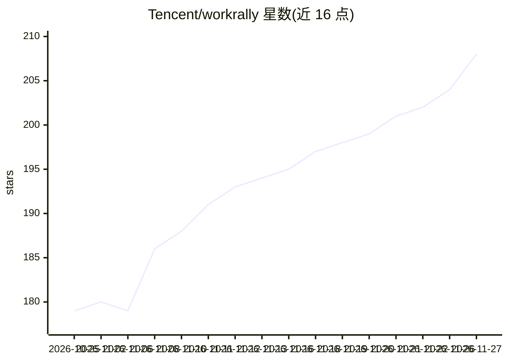

# Tencent/workrally

⭐ 208 · NOASSERTION · 推送 2026-11-06 · [GitHub](https://github.com/Tencent/workrally) · [官网](https://workrally.qq.com/) · 组织维护 · 中文 README

**给 AI Agent 调用 AIGC 漫剧视频创作流程的 CLI 技能集**

本仓库是 WorkRally CLI 的 Agent Skill 定义，以 SKILL.md 入口供 ClawHub 等商店解析，使 AI Agent 可调用漫剧视频创作全流程工具：基于 Kontext 模型的 AI 生图（多参考图、可选推理质量）、4 种驱动模式的 AI 生视频（含 draft 样片与成片升级）、gen_content 提示词优化、Yjs 协同无限画布、项目与媒资管理、企业知识库检索与写入，并可透传 WorkRally MCP Server 全部工具。使用前需 npm 全局安装并通过 auth login 登录。

## 筛选速览

| 维度 | 判定 | 备注 |
|---|---|---|
| AI 角色 | `ai-ecosystem` | LLM/agent 周边工具 |
| 许可风险 | `none` | NOASSERTION |
| 部署形态 | `library` | 以包/库形式分发 |
| 模型依赖 | — | README 未给出锁定关系 |
| 硬件要求 | — | 无带数字的原话,不猜 |
| 安装摩擦 | `low` | 无编译、无系统依赖或容器化 |
| 成熟度 | — | 结构信号不足 |

## 能力要点

- AI 生图（Kontext 模型）与 4 种驱动模式的 AI 生视频，支持低成本样片与成片升级
- gen_content 提示词优化任务，产物为 output_text
- Yjs 协同无限画布，8 种节点类型实时同步
- 可透传 WorkRally MCP Server 全部工具

## 适用场景

- 让 Agent 按文本或首尾帧驱动生成漫剧视频片段
- 在创作流程中让 Agent 管理项目素材与资产库
- 让 Agent 检索企业知识库辅助剧本创作

## 场景标签

`图像生成` `视频生成` `知识库管理` · 领域:内容生成

## 证据(README 行号)

> L1: # WorkRally CLI — Agent Skill
> L24: - **通用透传** — 可调用 WorkRally MCP Server 全部工具

## 星数曲线

2026-10-25 179 → 2026-11-27 208（+29）

---
*卡片 v1 · prompt 1.4 · 生成 2026-11-25 · 置信度 mid · 依据 README sha `bf8b33528757` · [字段定义](../../DATASET.md)*
