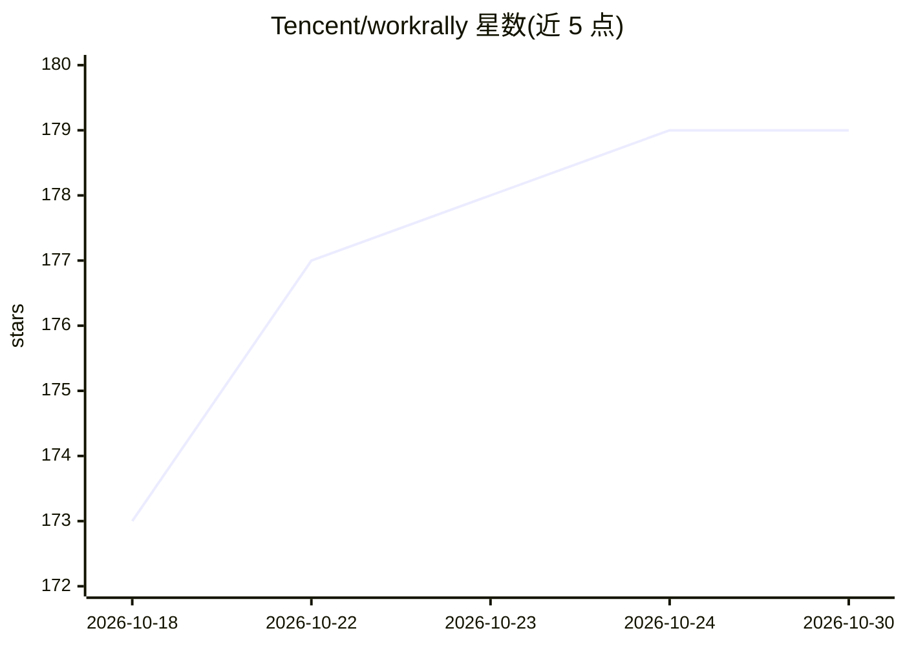

# Tencent/workrally

⭐ 179 · NOASSERTION · 推送 2026-09-29 · [GitHub](https://github.com/Tencent/workrally) · [官网](https://workrally.qq.com/) · 组织维护 · 中文 README

**面向 AI Agent 的 AIGC 漫剧视频创作 CLI 工具集**

以 Agent Skill 形式发布的 WorkRally CLI：通过 npm 全局安装并经 auth 登录后，供 AI Agent 调用，提供 AI 生图（Kontext 模型、多参考图）、AI 生视频（文本/首尾帧/参考主体/视频编辑 4 种驱动模式）、提示词优化、Yjs 协同的无限画布（8 种节点类型）以及项目与媒资管理能力，并可透传调用 WorkRally MCP Server 全部工具。Skill 定义由 ClawHub 解析 SKILL.md 生效。

## 筛选速览

| 维度 | 判定 | 备注 |
|---|---|---|
| AI 角色 | `ai-native` | 本体是模型或模型工具 |
| 许可风险 | `none` | NOASSERTION |
| 部署形态 | `library` | 以包/库形式分发 |
| 模型依赖 | — | README 未给出锁定关系 |
| 硬件要求 | — | 无带数字的原话,不猜 |
| 安装摩擦 | `low` | 无编译、无系统依赖或容器化 |
| 成熟度 | — | 结构信号不足 |

## 能力要点

- Kontext 模型 AI 生图，支持多参考图与可选推理质量
- 4 种驱动模式的 AI 生视频
- Yjs 协同无限画布，8 种节点类型实时同步
- 通用透传 WorkRally MCP Server 全部工具

## 适用场景

- 让 AI Agent 生成漫剧所需的图片与视频素材
- 通过 Agent 管理项目与素材资产库
- 在协同画布中组织创作流程

## 场景标签

`图像生成` `视频生成` `提示工程` · 领域:Agent 开发

## 证据(README 行号)

> L3: 🎬 面向 AI Agent 的 AIGC 漫剧视频创作全流程工具集。
> L18: - **AI 生图** — Kontext 模型，支持多参考图、可选推理质量
> L19: - **AI 生视频** — 4 种驱动模式（文本/首尾帧/参考主体/视频编辑）

## 星数曲线

2026-10-18 173 → 2026-10-30 179（+6）

---
*卡片 v1 · prompt 1.4 · 生成 2026-10-22 · 置信度 high · 依据 README sha `ec90be11867b` · [字段定义](../../DATASET.md)*
