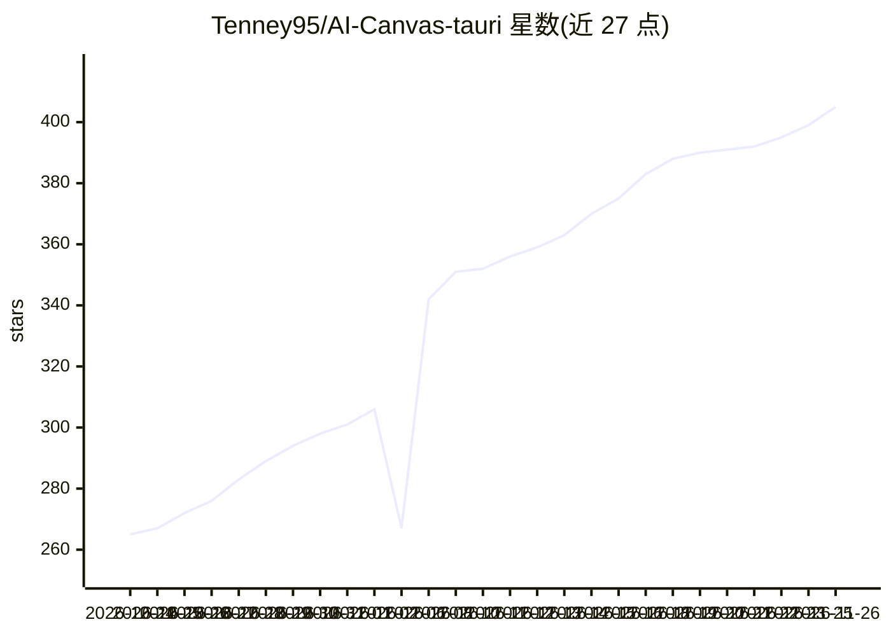

# Tenney95/AI-Canvas-tauri

⭐ 405 · TypeScript · NOASSERTION · 推送 2026-11-25 · [GitHub](https://github.com/Tenney95/AI-Canvas-tauri) · [官网](https://tenney95.github.io/AI-Canvas-tauri/) · 个人维护 · 中文 README

**面向短剧创作者的本地优先 AI 多模态画布桌面应用**

基于 Tauri 2 + React 19 + React Flow 12 的桌面应用，将文本、图像、视频、音频、动画、Markdown、分镜等组织为可连接的画布节点；集成 ComfyUI、对话 Agent 与 MCP，提供剧本写作、角色/场景/道具资产管理、帧动画编辑、内置视频剪辑、3D 导演台与剧集分集画布。本地优先存储项目与媒体，凭据独立管理；在线网页版仅可体验画布界面，插件、本地模型等能力需桌面环境。当前采用 Source-Available 许可，Stars 达 10k 后转 MIT。

## 筛选速览

| 维度 | 判定 | 备注 |
|---|---|---|
| AI 角色 | `ai-native` | 本体是模型或模型工具 |
| 许可风险 | `none` | NOASSERTION |
| 部署形态 | `library` | 以包/库形式分发 |
| 模型依赖 | — | README 未给出锁定关系 |
| 硬件要求 | — | 无带数字的原话,不猜 |
| 安装摩擦 | `low` | 无编译、无系统依赖或容器化 |
| 成熟度 | — | 结构信号不足 |

## 能力要点

- 多模态节点画布与剧本/分镜/剧集化管理，角色库整剧共享
- 连接 ComfyUI 多服务器、RunningHub、云端模型与本地 ONNX 模型
- 对话 Agent 可查询修改画布、生成媒体、派出只读子智能体
- MCP 外部控制：外部 AI 工具经 stdio 或 HTTP 控制画布与剪辑

## 适用场景

- 在一张画布上完成 AI 短剧从剧本、分镜到视频生成与剪辑
- 统一管理短剧的角色、场景、道具等创作资产与提示词
- 通过 ComfyUI 工作流批量生成图像和视频素材

## 场景标签

`图像生成` `视频生成` `AI 写作` · 领域:内容生成

## 证据(README 行号)

> L15: > 面向 **AI短剧创作、AI资产管理、图像/视频生成与分镜制作** 的本地优先 AI 多模态画布与可视化工作流桌面应用，集成 **ComfyUI、对话 AI Agent 与 MCP**，基于 **Tauri 2 + React
> L88: |AI 与工作流|连接云端与自定义模型、CCC、LibAPI 的文本/图片/视频/音频模型、ComfyUI 多服务器、RunningHub、通用工作流 API、Dreamina 和本地 ONNX 模型。|

## 星数曲线

2026-10-24 265 → 2026-11-26 405（+140）

---
*卡片 v1 · prompt 1.4 · 生成 2026-11-26 · 置信度 high · 依据 README sha `34f6847f7028` · [字段定义](../../DATASET.md)*
