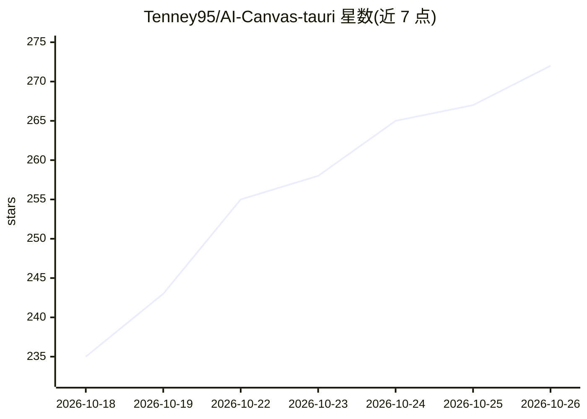

# Tenney95/AI-Canvas-tauri

⭐ 272 · TypeScript · NOASSERTION · 推送 2026-10-25 · [GitHub](https://github.com/Tenney95/AI-Canvas-tauri) · [官网](https://tenney95.github.io/AI-Canvas-tauri/) · 个人维护 · 中文 README

**面向 AI 短剧与分镜创作的本地优先多模态画布桌面应用**

基于 Tauri 2 + React 19 + React Flow 12 构建的桌面创作应用：将文本、图像、视频、音频、逐帧动画、分镜等组织为可连接的画布节点，支持剧集/分集结构与角色库、素材库管理。AI 侧接入 ComfyUI 多服务器与本地管理、云端模型、本地 ONNX 推理、对话 Agent（多会话、工具调用、只读子智能体）与 MCP 外部控制，并内置视频剪辑与三种导演台（轻量/Blender/AI 预演）。当前为 Source-Available 许可，10k Stars 后自有代码转 MIT；部分能力需 Tauri 桌面环境。

## 筛选速览

| 维度 | 判定 | 备注 |
|---|---|---|
| AI 角色 | `ai-native` | 本体是模型或模型工具 |
| 许可风险 | `none` | NOASSERTION |
| 部署形态 | `library` | 以包/库形式分发 |
| 模型依赖 | — | README 未给出锁定关系 |
| 硬件要求 | — | 无带数字的原话,不猜 |
| 安装摩擦 | `low` | 无编译、无系统依赖或容器化 |
| 成熟度 | — | 结构信号不足 |

## 能力要点

- 多模态节点画布与剧集/分集结构，角色库与素材整部剧共用
- ComfyUI 多服务器/本地管理与云端模型、本地 ONNX 推理接入
- 对话 Agent：工具调用、只读子智能体、项目记忆
- 内置多轨视频剪辑与 Blender/AI 预演三种导演台

## 适用场景

- 从创意、分镜到成片在同一画布中编排 AI 短剧
- 统一管理角色、参考图与生成素材并反推提示词
- 通过对话助手或 MCP 外部工具操作画布与剪辑工程

## 场景标签

`图像生成` `视频生成` `多模态` · 领域:内容生成

## 证据(README 行号)

> L15: > 面向 **AI短剧创作、AI资产管理、图像/视频生成与分镜制作** 的本地优先 AI 多模态画布与可视化工作流桌面应用，集成 **ComfyUI、对话 AI Agent 与 MCP**，基于 **Tauri 2 + React
> L17: AI Canvas Tauri 将文本、图像、视频、音频、逐帧动画、Markdown、分镜、360° 全景和手绘笔记组织成可连接的画布节点。你可以在同一个项目中编排生成链路、统一管理角色库、人物/场景/道具与本地素材、执行 Com
> L64: |AI 与工作流|云端模型、自定义模型执行协议与试跑、CCC 统一入口管理多分组 Key、按模型自动匹配、ComfyUI 多服务器与本地管理（模型去重、运行控制台）、RunningHub 云工作流/AI 应用、通用工作流 API（

## 星数曲线

2026-10-18 235 → 2026-10-26 272（+37）

---
*卡片 v1 · prompt 1.4 · 生成 2026-10-22 · 置信度 high · 依据 README sha `4151ae3c39c5` · [字段定义](../../DATASET.md)*
