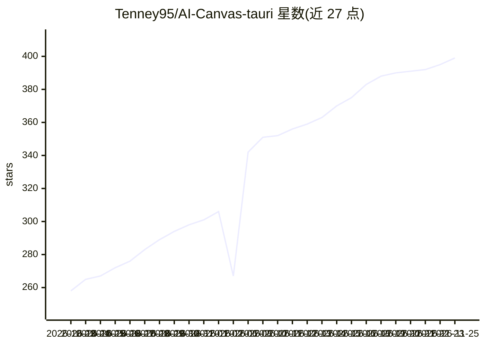

# Tenney95/AI-Canvas-tauri

⭐ 399 · TypeScript · NOASSERTION · 推送 2026-11-23 · [GitHub](https://github.com/Tenney95/AI-Canvas-tauri) · [官网](https://tenney95.github.io/AI-Canvas-tauri/) · 个人维护 · 中文 README

**面向短剧创作者的本地优先无限画布，集成生成与剪辑**

基于 Tauri 2 + React 19 + React Flow 12 的桌面多模态画布应用：将文本、图像、视频、音频、逐帧动画、分镜、3D 全景组织为可连接节点，覆盖剧本写作、角色/场景/道具资产管理、ComfyUI 多服务器工作流执行、图像/视频生成、内置多轨视频剪辑与剧集分集管理。支持对话 Agent 与 Skill 协作、MCP 外部控制（默认关闭）、JS/Python 用户插件。提供在线体验版（部分能力受限）与桌面安装包；当前许可为 Source-Available，声明 Stars 达 10k 后转 MIT。

## 筛选速览

| 维度 | 判定 | 备注 |
|---|---|---|
| AI 角色 | `ai-native` | 本体是模型或模型工具 |
| 许可风险 | `none` | NOASSERTION |
| 部署形态 | `library` | 以包/库形式分发 |
| 模型依赖 | — | README 未给出锁定关系 |
| 硬件要求 | — | 无带数字的原话,不猜 |
| 安装摩擦 | `low` | 无编译、无系统依赖或容器化 |
| 成熟度 | — | 结构信号不足 |

## 能力要点

- 多模态节点画布：文本/图像/视频/音频/动画/分镜/3D 可连接编排
- 连接 ComfyUI 多服务器与 RunningHub、本地 ONNX 模型执行生成工作流
- 内置多轨视频剪辑器与逐帧动画编辑导出
- 对话 Agent 协作、只读子智能体、MCP 外部控制

## 适用场景

- 从剧本、分镜到视频生成与剪辑完成一部 AI 短剧
- 统一管理角色、场景、道具素材与提示词
- 在画布上编排 ComfyUI 工作流并批量生成视频
- 通过外部 AI 工具经 MCP 控制画布与剪辑

## 场景标签

`图像生成` `视频生成` `多模态` `AI 写作` · 领域:内容生成

## 证据(README 行号)

> L15: > 面向 **AI短剧创作、AI资产管理、图像/视频生成与分镜制作** 的本地优先 AI 多模态画布与可视化工作流桌面应用，集成 **ComfyUI、对话 AI Agent 与 MCP**，基于 **Tauri 2 + React
> L88: |AI 与工作流|连接云端与自定义模型、CCC、LibAPI 的文本/图片/视频/音频模型、ComfyUI 多服务器、RunningHub、通用工作流 API、Dreamina 和本地 ONNX 模型。|
> L104: |MCP 外部控制|让外部 AI 工具通过本机 stdio 或 Streamable HTTP 控制画布、媒体和剪辑项目。默认关闭，远程连接需确认启用。|

## 星数曲线

2026-10-23 258 → 2026-11-25 399（+141）

---
*卡片 v1 · prompt 1.4 · 生成 2026-11-25 · 置信度 mid · 依据 README sha `29fd890a1c80` · [字段定义](../../DATASET.md)*
