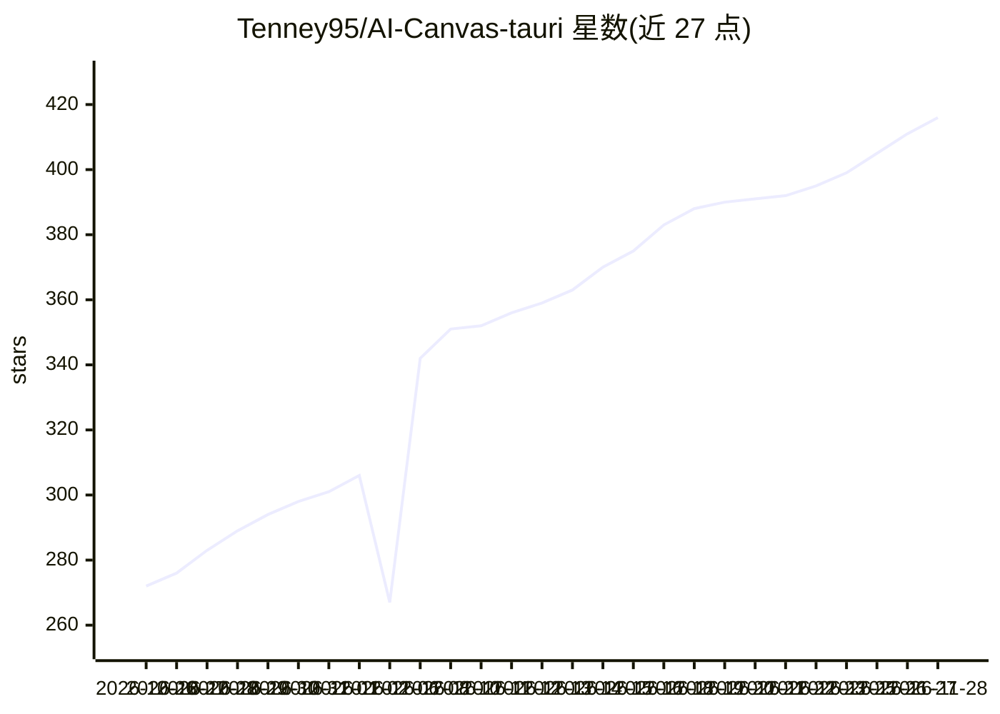

# Tenney95/AI-Canvas-tauri

⭐ 416 · TypeScript · NOASSERTION · 推送 2026-11-27 · [GitHub](https://github.com/Tenney95/AI-Canvas-tauri) · [官网](https://tenney95.github.io/AI-Canvas-tauri/) · 个人维护 · 中文 README

**本地优先的 AI 无限画布，用于短剧剧本、分镜与图像/视频生成**

基于 Tauri 2 + React 19 + React Flow 12 的桌面多模态画布应用：把文本、图像、视频、音频、逐帧动画、分镜、全景与手绘笔记组织为可连接节点，集成 ComfyUI、RunningHub 等云端/自定义模型与本地 ONNX 模型执行生成，提供角色库与资产管理、剧本写作与 AI 续写润色、故事关系图、内置多轨视频剪辑、MCP 外部控制与用户插件机制。支持简中/英/日/韩界面，项目本地保存、凭据独立存储。Web 在线版仅覆盖部分能力，插件、本地模型等需桌面环境。

## 筛选速览

| 维度 | 判定 | 备注 |
|---|---|---|
| AI 角色 | `ai-native` | 本体是模型或模型工具 |
| 许可风险 | `none` | NOASSERTION |
| 部署形态 | `library` | 以包/库形式分发 |
| 模型依赖 | — | README 未给出锁定关系 |
| 硬件要求 | — | 无带数字的原话,不猜 |
| 安装摩擦 | `low` | 无编译、无系统依赖或容器化 |
| 成熟度 | — | 结构信号不足 |

## 能力要点

- 多模态节点画布，编排文本/图像/视频/音频/动画/分镜
- 集成 ComfyUI 多服务器、RunningHub、Dreamina 与本地 ONNX 模型
- 对话 Agent 协作创作：多模型团队、只读子智能体、项目记忆
- 剧集与分集画布共享角色库与素材，MCP 外部控制

## 适用场景

- 把短剧剧本、角色、分镜和生成的视频放在同一张画布上管理
- 统一管理人物/场景/道具素材并复用提示词
- 通过 ComfyUI 工作流批量生成图片和视频
- 在画布内完成多轨剪辑与视频导出

## 场景标签

`图像生成` `视频生成` `多模态` · 领域:内容生成

## 证据(README 行号)

> L15: > 面向 **AI短剧创作、AI资产管理、图像/视频生成与分镜制作** 的本地优先 AI 多模态画布与可视化工作流桌面应用，集成 **ComfyUI、对话 AI Agent 与 MCP**，基于 **Tauri 2 + React
> L88: |AI 与工作流|连接云端与自定义模型、CCC、LibAPI 的文本/图片/视频/音频模型、ComfyUI 多服务器、RunningHub、通用工作流 API、Dreamina 和本地 ONNX 模型。|
> L17: AI Canvas Tauri 将文本、图像、视频、音频、逐帧动画、Markdown、分镜、360° 全景和手绘笔记组织成可连接的画布节点。你可以在同一个项目中编排生成链路、统一管理角色库、人物/场景/道具与本地素材、执行 Com

## 星数曲线

2026-10-26 272 → 2026-11-28 416（+144）

---
*卡片 v1 · prompt 1.4 · 生成 2026-11-28 · 置信度 high · 依据 README sha `804d93065325` · [字段定义](../../DATASET.md)*
