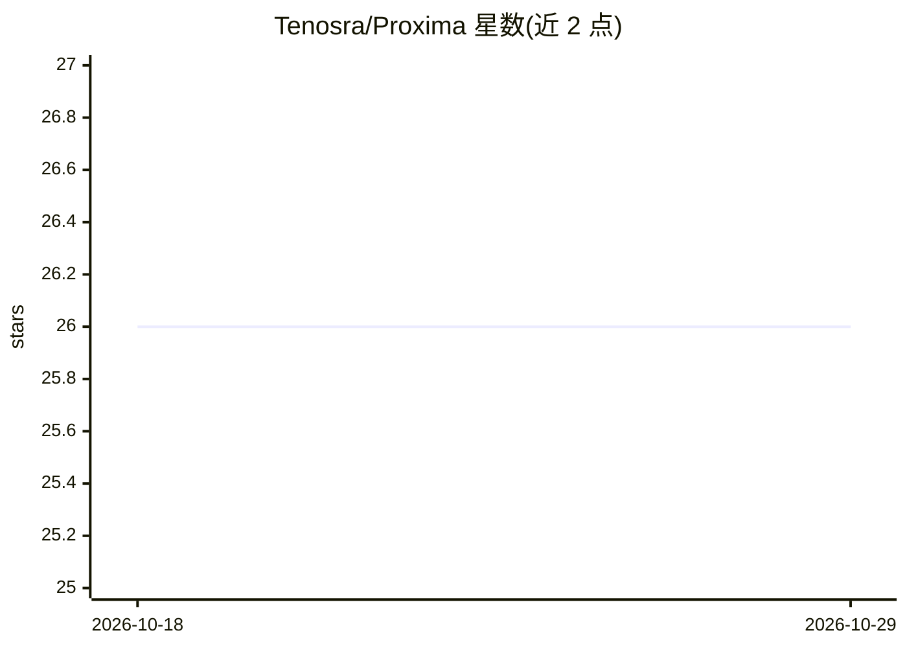

# Tenosra/Proxima

⭐ 26 · Python · Apache-2.0 · 推送 2026-08-19 · [GitHub](https://github.com/Tenosra/Proxima) · [官网](https://tenosra.com/proxima) · 个人维护

**vLLM 插件：低秩 KV 缓存压缩，让同等 GPU 承载更多并发请求**

面向 vLLM 的树外插件，实现 ICML 2026 论文 STAR-KV 的低秩 KV 缓存压缩：用逐层低秩投影（K 头级分解、V 联合分解）替代全维度 KV 缓存，经离线短程知识蒸馏校准，以压缩分页格式存储，通过专用 Triton 内核接入 vLLM V1 连续批处理服务栈。README 报告在 L4 24GB 上并发容量 4x、KV 块 3.11x、可启动更长上下文；适用内存受限而非延迟受限场景，batch 1 时解码内核慢于 FlashAttention-2。不在 PyPI，需源码安装，且锁定 vllm==0.10.1.1；端到端验证仅覆盖 longchat-7b-v1.5-32k 一个模型。

## 筛选速览

| 维度 | 判定 | 备注 |
|---|---|---|
| AI 角色 | `ai-ecosystem` | LLM/agent 周边工具 |
| 许可风险 | `permissive` | Apache-2.0 |
| 部署形态 | `library` | 以包/库形式分发 |
| 模型依赖 | local-ok | 支持本地模型 |
| 硬件要求 | — | 无带数字的原话,不猜 |
| 安装摩擦 | `medium` | 含编译或系统依赖之一 |
| 成熟度 | — | 结构信号不足 |

## 能力要点

- STAR-KV 低秩 KV 压缩（K 头级、V 联合分解）+ 离线蒸馏校准
- 专用 Triton 内核接入 vLLM V1 连续批处理/分页注意力栈
- README 报告 L4 上并发 4x、KV 块 3.11x、32k 上下文可启动
- 解码内核在 batch≥16 时快于 FlashAttention-2（1.2-1.46x）

## 适用场景

- 显存不够装下目标并发数或上下文长度时扩展 vLLM 容量
- 在消费级 GPU（如 L4 24GB）上跑 16k-32k 长上下文服务
- 牺牲单请求延迟换取不 OOM、可启动的服务容量

## 场景标签

`推理引擎` `模型量化` · 领域:训练与推理

## 证据(README 行号)

> L12: An out-of-tree vLLM plugin implementing STAR-KV — low-rank KV cache compression via
> L19: that pipeline and wires it into vLLM's V1 continuous-batching, paged-attention serving stack

## 星数曲线

2026-10-18 26 → 2026-10-29 26（+0）

---
*卡片 v1 · prompt 1.4 · 生成 2026-10-26 · 置信度 mid · 依据 README sha `7328fd6a2e61` · [字段定义](../../DATASET.md)*
