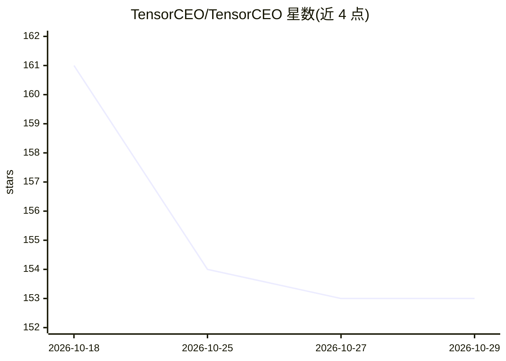

# TensorCEO/TensorCEO

⭐ 153 · 推送 2026-03-29 · [GitHub](https://github.com/TensorCEO/TensorCEO) · 个人维护 · 中文 README

**计算机毕设源码与定制指导服务：AI 模型+系统开发全流程**

个人运营的毕业设计服务仓库：以“Tensor正阳学长”名义提供原创 AI 毕设源码（含演示视频、技术文档、论文大纲），并承接本硕毕设定制，覆盖开题报告、实验指导、系统开发、论文终稿与本地部署。README 将 AI 毕设分为算法模型研究、AI 模型+系统开发、算法改进+系统开发三种类型，列有心力衰竭检测、音乐推荐等源码条目（链接未展示实际内容）。联系方式为 QQ、B站与闲鱼。

## 筛选速览

| 维度 | 判定 | 备注 |
|---|---|---|
| AI 角色 | `ai-knowledge` | 知识聚合/清单类 |
| 许可风险 | `none` | — |
| 部署形态 | `None` |  |
| 模型依赖 | — | README 未给出锁定关系 |
| 硬件要求 | — | 无带数字的原话,不猜 |
| 安装摩擦 | `low` | 无编译、无系统依赖或容器化 |
| 成熟度 | — | 结构信号不足 |

## 能力要点

- 原创毕设源码附演示视频、技术文档与论文大纲
- 本硕毕设定制：开题、中期、答辩全流程指导
- AI 毕设分三类方案（算法研究/模型+系统/算法改进+系统）

## 适用场景

- 购买 AI 方向计算机毕业设计的现成源码与配套材料
- 寻求从选题到答辩的全流程毕设定制指导
- 参考 AI 模型结合系统开发类毕设题目思路

## 场景标签

 · 领域:教育/毕设服务

## 证据(README 行号)

> L21: 提供高质量毕设源码（**所有项目皆原创，全网独家**）
> L27: ## ✅ 毕设定制（本/硕皆可）
> L77: |基于深度学习的心力衰竭检测系统（原创源码+原创论文)|查看内容|

## 星数曲线

2026-10-18 161 → 2026-10-29 153（-8）

---
*卡片 v1 · prompt 1.4 · 生成 2026-10-22 · 置信度 high · 依据 README sha `df126dfbcfd7` · [字段定义](../../DATASET.md)*
