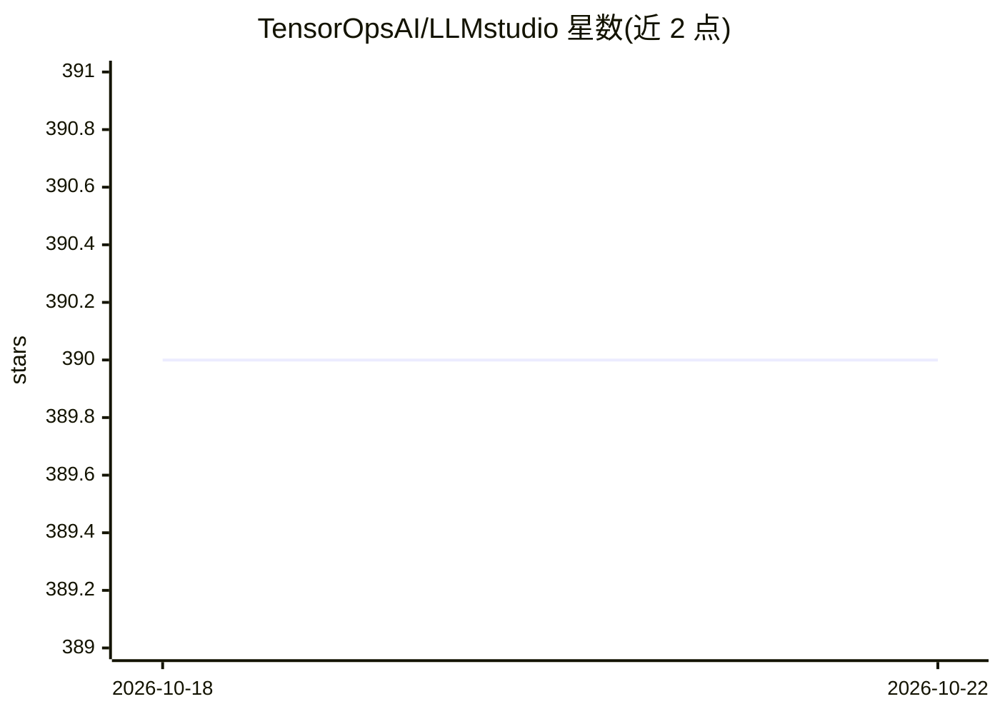

# TensorOpsAI/LLMstudio

⭐ 390 · Python · MPL-2.0 · 推送 2026-07-29 · [GitHub](https://github.com/TensorOpsAI/LLMstudio) · [官网](https://tensorops.ai) · 组织维护

**帮助开发者将 LLM 应用推向生产的框架与工具集**

面向开发者的 LLM 应用生产化框架：提供 LLM 代理访问（OpenAI/Anthropic/Google）、通过 Ollama 接入自定义或本地开源模型、Prompt Playground UI、Python SDK、请求监控与日志、LangChain 集成、批量调用以及智能路由与故障转移。安装分完整版（含 proxy/tracker）与轻量核心版，均经 pip 安装，通过 .env 配置 API key 后以 llmstudio server 命令启动代理与追踪服务，各自暴露 Swagger 文档端口。

## 筛选速览

| 维度 | 判定 | 备注 |
|---|---|---|
| AI 角色 | `ai-ecosystem` | LLM/agent 周边工具 |
| 许可风险 | `permissive` | MPL-2.0 |
| 部署形态 | `library` | 以包/库形式分发 |
| 模型依赖 | local-ok | 支持本地模型 |
| 硬件要求 | — | 无带数字的原话,不猜 |
| 安装摩擦 | `low` | 无编译、无系统依赖或容器化 |
| 成熟度 | — | 结构信号不足 |

## 能力要点

- 代理访问 OpenAI/Anthropic/Google 的模型，支持经 Ollama 使用本地开源模型
- Prompt Playground UI 用于提示词工程与调优
- 请求监控、日志与智能路由/故障转移
- 提供 Python SDK 并集成 LangChain

## 适用场景

- 统一入口管理与切换多家 LLM 提供商
- 在 Playground 中调试提示词后接入生产流程
- 为 LLM 应用添加请求监控与可用性保障

## 场景标签

`模型网关` `提示工程` `LLM 可观测性` · 领域:Agent 开发

## 证据(README 行号)

> L11: - **LLM Proxy Access**: Seamless access to all the latest LLMs by OpenAI, Anthropic, Google.
> L14: - **Python SDK**: Easily integrate LLMstudio into your existing workflows.
> L15: - **Monitoring and Logging**: Keep track of your usage and performance for all requests.

## 星数曲线

2026-10-18 390 → 2026-10-22 390（+0）

---
*卡片 v1 · prompt 1.4 · 生成 2026-10-21 · 置信度 high · 依据 README sha `80689d3fb214` · [字段定义](../../DATASET.md)*
