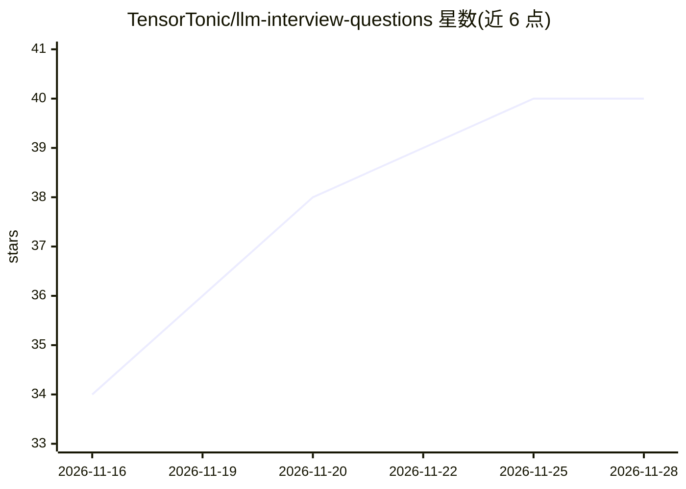

# TensorTonic/llm-interview-questions

⭐ 40 · MIT · 推送 2026-11-10 · [GitHub](https://github.com/TensorTonic/llm-interview-questions) · [官网](https://www.tensortonic.com/llm-internals) · 个人维护

**LLM/Transformer 面试题清单：39 题配讲解与 Python 练习**

面向准备 ML 工程师、研究/后训练岗位面试者的结构化题库：39 道题按四个阶段组织，从 tokenization、注意力、KV cache 到训练动态、RLHF/DPO/GRPO、推理服务（量化、PagedAttention、投机解码）以及评测、RAG 与系统设计。每题链接到解释文章和用 Python 实现并用测试验证的练习题，完成阶段后可用限时面试自测评估。读者需具备基础 Python 与神经网络常识。

## 筛选速览

| 维度 | 判定 | 备注 |
|---|---|---|
| AI 角色 | `ai-knowledge` | 知识聚合/清单类 |
| 许可风险 | `permissive` | MIT |
| 部署形态 | `None` |  |
| 模型依赖 | — | README 未给出锁定关系 |
| 硬件要求 | — | 无带数字的原话,不猜 |
| 安装摩擦 | `low` | 无编译、无系统依赖或容器化 |
| 成熟度 | — | 结构信号不足 |

## 能力要点

- 39 道题分四个阶段，覆盖架构、训练、推理服务与评测/RAG
- 每题配讲解链接与 Python 实现练习（含测试验证）
- 提供限时面试自测（LLM Internals、Decoding Primitives 等题组）

## 适用场景

- 准备 ML 工程师或 LLM 相关岗位的技术面试
- 自测对 transformer/LLM 各环节的掌握程度
- 通过亲手实现注意力、KV cache 等组件巩固理解

## 场景标签

`教程课程` · 领域:学习与行业

## 证据(README 行号)

> L7: This is a list of the transformer and large language model questions that come up most often in ML engineer and rese
> L9: Every question links to an explanation that covers the answer and to practice problems where you implement the idea 

## 星数曲线

2026-11-16 34 → 2026-11-28 40（+6）

---
*卡片 v1 · prompt 1.4 · 生成 2026-11-18 · 置信度 high · 依据 README sha `7227ad951a1c` · [字段定义](../../DATASET.md)*
