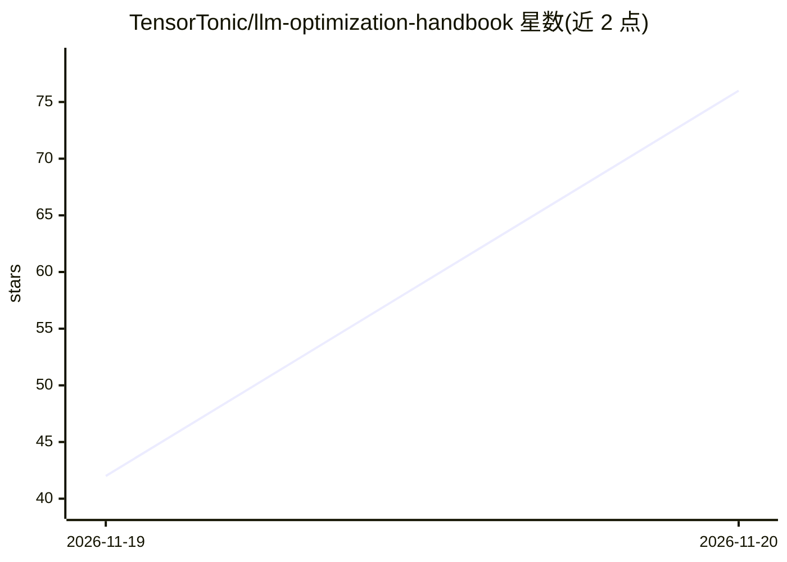

# TensorTonic/llm-optimization-handbook

⭐ 76 · MIT · 推送 2026-11-10 · [GitHub](https://github.com/TensorTonic/llm-optimization-handbook) · [官网](https://www.tensortonic.com) · 个人维护

**LLM 推理优化学习路线图：48 主题、7 阶段、配套练习**

一份以学习路线形式组织的 LLM 推理优化教程，按 7 个阶段覆盖 48 个主题：推理基础、量化、KV Cache 与注意力、投机解码与 MoE、GPU 内核、批处理与并行、生产服务。每个主题链接到说明文章与练习题，练习要求用 Python、CUDA 或 Triton 实现并通过测试。面向想理解推理为何慢的 ML 工程师、准备推理方向面试者与生产环境运维者，需 Python 基础，Stage 5 之前不需 GPU 编程经验。

## 筛选速览

| 维度 | 判定 | 备注 |
|---|---|---|
| AI 角色 | `ai-knowledge` | 知识聚合/清单类 |
| 许可风险 | `permissive` | MIT |
| 部署形态 | `None` |  |
| 模型依赖 | — | README 未给出锁定关系 |
| 硬件要求 | — | 无带数字的原话,不猜 |
| 安装摩擦 | `medium` | 含编译或系统依赖之一 |
| 成熟度 | — | 结构信号不足 |

## 能力要点

- 7 阶段 48 主题的推理优化路线图，覆盖量化到生产服务
- 每主题配实践题，用 Python/CUDA/Triton 实现并对照测试
- 围绕 measure→bottleneck→optimize 的优化循环组织内容
- 附带 Cracking Inference 练习合集与 LLM Internals 图解指引

## 适用场景

- 系统学习 LLM 推理优化技术栈
- 准备推理工程或 ML 系统方向的面试
- 生产环境服务模型时按清单排查瓶颈

## 场景标签

`教程课程` · 领域:学习与行业

## 证据(README 行号)

> L7: This is a roadmap for making large language models faster, cheaper and smaller to run. It covers 48 topics across se
> L9: Every topic links to a short explanation and to practice problems where you implement the idea in Python, CUDA or Tr

## 星数曲线

2026-11-19 42 → 2026-11-20 76（+34）

---
*卡片 v1 · prompt 1.4 · 生成 2026-11-19 · 置信度 high · 依据 README sha `3de48e4dc1dd` · [字段定义](../../DATASET.md)*
