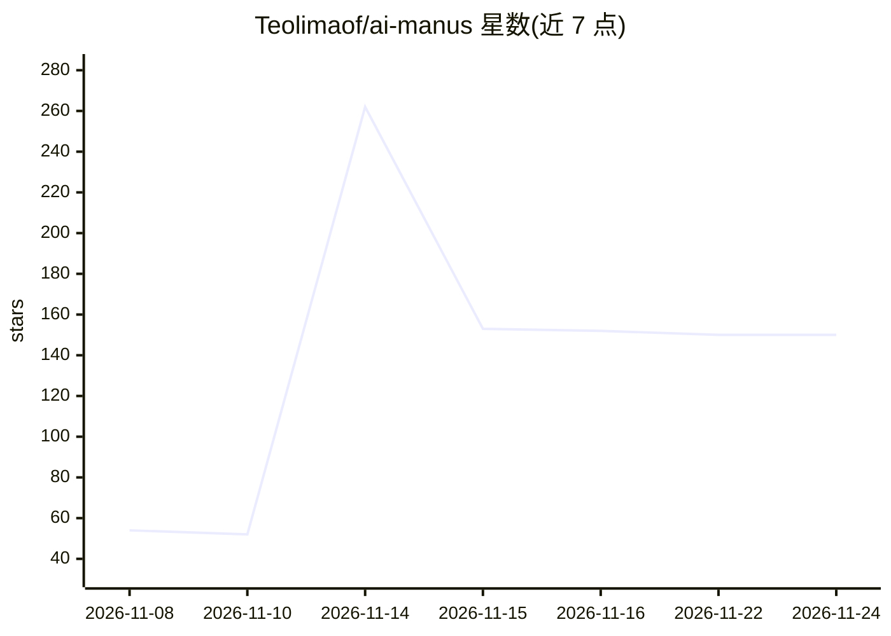

# Teolimaof/ai-manus

⭐ 148 · Python · Apache-2.0 · 推送 2026-11-08 · [GitHub](https://github.com/Teolimaof/ai-manus) · 个人维护

**自主执行代码与控制浏览器的通用 AI Agent 系统**

面向家庭、学习与轻量办公场景的自主 AI agent：可自行编写并执行脚本、打开网页并与之交互、执行多步骤任务，减少手动操作。README 以功能介绍与使用流程为主，包含硬件兼容表（最低双核 CPU / 4 GB 内存）与配置测试步骤，但未给出具体的安装命令、技术栈实现或模型接入方式等可验证细节。

## 筛选速览

| 维度 | 判定 | 备注 |
|---|---|---|
| AI 角色 | `ai-native` | 本体是模型或模型工具 |
| 许可风险 | `permissive` | Apache-2.0 |
| 部署形态 | `None` |  |
| 模型依赖 | — | README 未给出锁定关系 |
| 硬件要求 | — | 无带数字的原话,不猜 |
| 安装摩擦 | `low` | 无编译、无系统依赖或容器化 |
| 成熟度 | — | 结构信号不足 |

## 能力要点

- 自主编写并执行代码以完成任务
- 浏览器控制：导航网页、填写表单、收集信息
- 脚本与浏览器操作可在同一工作流中衔接
- 跨会话记忆工作流模式

## 适用场景

- 整理研究资料、运行小脚本的学习辅助
- 从多个网页收集信息并准备摘要
- 自动化日常重复性小任务

## 场景标签

`浏览器自动化` `编码 Agent` · 领域:效率与自动化

## 证据(README 行号)

> L10: - **Autonomous Code Execution:** Manus AI agent runs code on its own to complete tasks, so you can focus on decisio
> L18: Manus is an autonomous AI agent designed to run code and control a browser on your behalf. Instead of acting like a

## 星数曲线

2026-11-08 54 → 2026-11-24 150（+96）

---
*卡片 v1 · prompt 1.4 · 生成 2026-11-17 · 置信度 mid · 依据 README sha `98056f9e98b8` · [字段定义](../../DATASET.md)*
