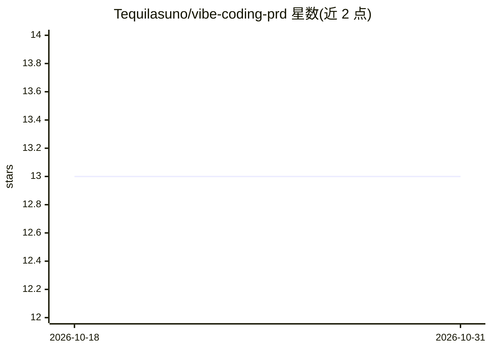

# Tequilasuno/vibe-coding-prd

⭐ 13 · MIT · 推送 2026-07-02 · [GitHub](https://github.com/Tequilasuno/vibe-coding-prd) · 个人维护 · 中文 README

**Claude Code skill：把需求/原始 PRD/竞品分析转为编码可用的 PRD**

一个 Claude Code 自定义 skill 包，将需求描述、原始 PRD（含飞书文档）或竞品分析整理成精简、结构化、可直接交给编码 Agent（Claude Code / Codex）实现的 Markdown PRD。主流程为 SKILL.md 定义的输入识别→需求定义→功能清单+优先级→技术栈→原型线框→明细模块→验收标准→自检交付，配套 PRD 模板、写作约定（字面量规则、反模式对照表、否定约束）与成品语料。通过 git clone 放入 ~/.claude/skills 目录安装，在 Claude Code 中以自然语言触发。

## 筛选速览

| 维度 | 判定 | 备注 |
|---|---|---|
| AI 角色 | `ai-knowledge` | 知识聚合/清单类 |
| 许可风险 | `permissive` | MIT |
| 部署形态 | `None` |  |
| 模型依赖 | — | README 未给出锁定关系 |
| 硬件要求 | — | 无带数字的原话,不猜 |
| 安装摩擦 | `low` | 无编译、无系统依赖或容器化 |
| 成熟度 | — | 结构信号不足 |

## 能力要点

- SKILL.md 定义八步 PRD 生成主流程
- 支持读取飞书文档形式的原始 PRD
- 配套 PRD 模板（含假设决策块与交付前检查清单）与精度约定
- 提供成品 PRD 语料示例

## 适用场景

- 把手头的需求描述整理成可直接交给编码 Agent 的 PRD
- 把飞书文档形式的原始 PRD 精简为结构化 Markdown PRD
- 基于竞品分析生成新产品的 PRD

## 场景标签

`提示工程` · 领域:Agent 开发

## 证据(README 行号)

> L3: Claude Code 自定义 skill：把需求描述 / 原始PRD（含飞书文档）/ 竞品分析整理成一份精简、结构化、可直接喂给编码 Agent（Claude Code / Codex）实现的 Markdown PRD。
> L21: |`SKILL.md`|主流程：输入识别 → 需求定义 → 功能清单+优先级 → 技术栈 → 原型线框 → 明细模块 → 验收标准 → 自检交付|

## 星数曲线

2026-10-18 13 → 2026-10-31 13（+0）

---
*卡片 v1 · prompt 1.4 · 生成 2026-10-31 · 置信度 high · 依据 README sha `9428d33c292c` · [字段定义](../../DATASET.md)*
