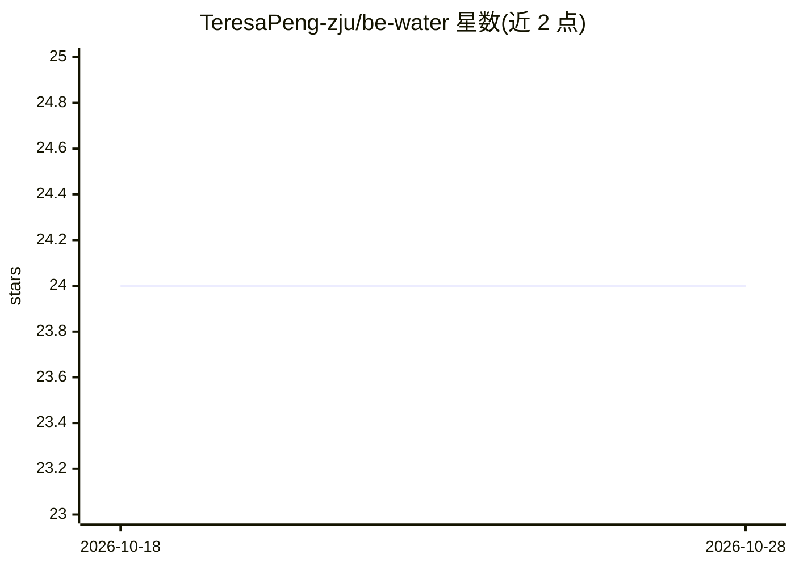

# TeresaPeng-zju/be-water

⭐ 24 · TypeScript · Apache-2.0 · 推送 2026-08-09 · [GitHub](https://github.com/TeresaPeng-zju/be-water) · [官网](https://be-water.vercel.app/workspace) · 个人维护 · 中文 README

**面向个人销售与自由职业者的 AI 经营记忆与增长行动系统**

基于 Next.js 15 的 local-first 网页应用：将咨询聊天、会议转写、交付记录、客户反馈等真实经营材料沉淀为浏览器本地存储的经营记忆（客户、案例、Evidence、Outcome），由 Bee 生成可执行的增长行动、渠道素材与指标复盘，每项判断可回溯到原始记录。模型抽取为可选，未配置 API Key 时降级为本地规则；当前为可交互原型，无云同步，支持中英文界面。另含可独立使用的 WorkBuddy Skill。

## 筛选速览

| 维度 | 判定 | 备注 |
|---|---|---|
| AI 角色 | `ai-native` | 本体是模型或模型工具 |
| 许可风险 | `permissive` | Apache-2.0 |
| 部署形态 | `library` | 以包/库形式分发 |
| 模型依赖 | — | README 未给出锁定关系 |
| 硬件要求 | — | 无带数字的原话,不猜 |
| 安装摩擦 | `low` | 无编译、无系统依赖或容器化 |
| 成熟度 | `idea` | |

## 能力要点

- 原始材料沉淀为可溯源的经营记忆（Evidence/Outcome/案例状态）
- 跨案例重复信号提升为模式，区分自述、可观察变化与独立验证
- local-first：经营记忆存浏览器本地，JSON 记忆包导入导出
- 未配置模型 API Key 时降级为本地规则整理

## 适用场景

- 把客户咨询、交付与反馈整理成可追溯的经营记忆
- 获得本周最值得做的获客行动与跟进话术
- 记录曝光、成交与收入，让结果反哺下一轮判断

## 场景标签

`知识库管理` · 领域:知识与检索

## 证据(README 行号)

> L14: BeWater 是一套基于 WorkBuddy，面向个人销售、自由职业者与小型专业服务团队的 AI 经营增长搭档。
> L16: 它不从 Prompt 开始，而从真实经营开始。咨询聊天、报价预约、会议记录、交付材料、客户反馈与成交结果，会持续沉淀为用户拥有的经营记忆。Bee 基于这些真实经营事实理解业务、形成经营判断，并生成下一步最值得执行的增长行动。

## 星数曲线

2026-10-18 24 → 2026-10-28 24（+0）

---
*卡片 v1 · prompt 1.4 · 生成 2026-10-27 · 置信度 mid · 依据 README sha `da93395fd139` · [字段定义](../../DATASET.md)*
