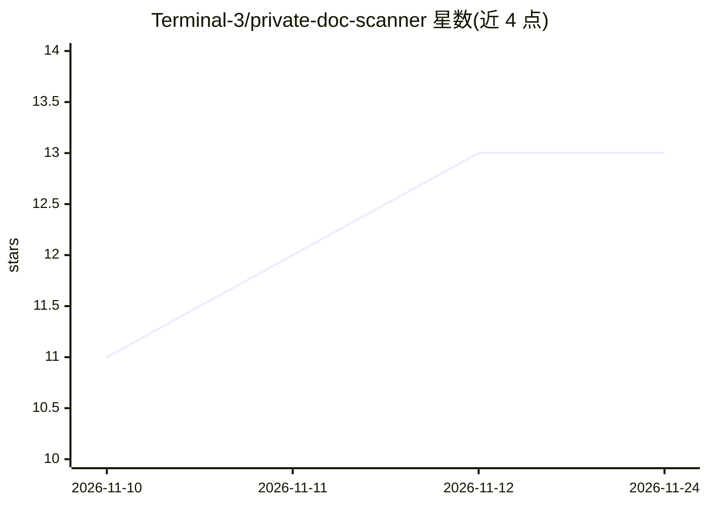

# Terminal-3/private-doc-scanner

⭐ 13 · TypeScript · Apache-2.0 · 推送 2026-11-17 · [GitHub](https://github.com/Terminal-3/private-doc-scanner) · [官网](https://experiments-eta-ten.vercel.app/) · 组织维护

**在设备端读取证件与账单、封存到自有加密保险库的隐私扫描器**

一个静态 Web/PWA 扫描器：在用户手机或桌面浏览器上读取护照、ID 卡、工资单、银行对账单，运行确定性校验（ICAO 9303 MRZ 校验位、算术核对、IBAN mod-97），用户逐字段确认后仅将确认的值加密封存到其自有 Terminal 3 DID 保险库（Intel TDX enclave），AI agent 只能获得是/否判定。OCR 引擎运行时选择 PP-OCRv4（WebGPU/WASM）或 Tesseract，支持离线运行；封存需 Terminal 3 账户与 API key，提供 Claude Code/Codex 配置 prompt 与插件安装。

## 筛选速览

| 维度 | 判定 | 备注 |
|---|---|---|
| AI 角色 | `ai-native` | 本体是模型或模型工具 |
| 许可风险 | `permissive` | Apache-2.0 |
| 部署形态 | `library` | 以包/库形式分发 |
| 模型依赖 | — | README 未给出锁定关系 |
| 硬件要求 | — | 无带数字的原话,不猜 |
| 安装摩擦 | `low` | 无编译、无系统依赖或容器化 |
| 成熟度 | — | 结构信号不足 |

## 能力要点

- 设备端读取，文档文件不上传，仅确认字段加密后离开设备
- 确定性校验机制：MRZ 校验位、算术核对、IBAN mod-97，未通过校验的字段标记人工复核
- 封存前验证 Intel TDX 硬件证明（ML-KEM/HPKE RFC 9180 加密）
- PP-OCRv4/Tesseract 运行时自适应，峰值内存约 300 MB，Web Worker 内 OCR

## 适用场景

- 让 AI 助手核验收入或证件有效期而看不到文档内容
- 贷款、租房、订阅的自动化收入与余额预核验
- 扫描护照后由 agent 通过 Duffel 订机票

## 场景标签

`OCR` `文档解析` · 领域:知识与检索

## 证据(README 行号)

> L3: **Open-source document scanner for AI: reads your passport, payslip or bank statement on your own device and saves i
> L79: - **What it does:** a user scans a passport, ID card, payslip or bank statement on their phone; only the details th
> L161: The reading engine is picked at runtime: PP-OCRv4 on WebGPU on recent desktops and Android, PP-OCRv4 on WASM on Sa

## 星数曲线

2026-11-10 11 → 2026-11-24 13（+2）

---
*卡片 v1 · prompt 1.4 · 生成 2026-11-18 · 置信度 high · 依据 README sha `9a524bb97346` · [字段定义](../../DATASET.md)*
