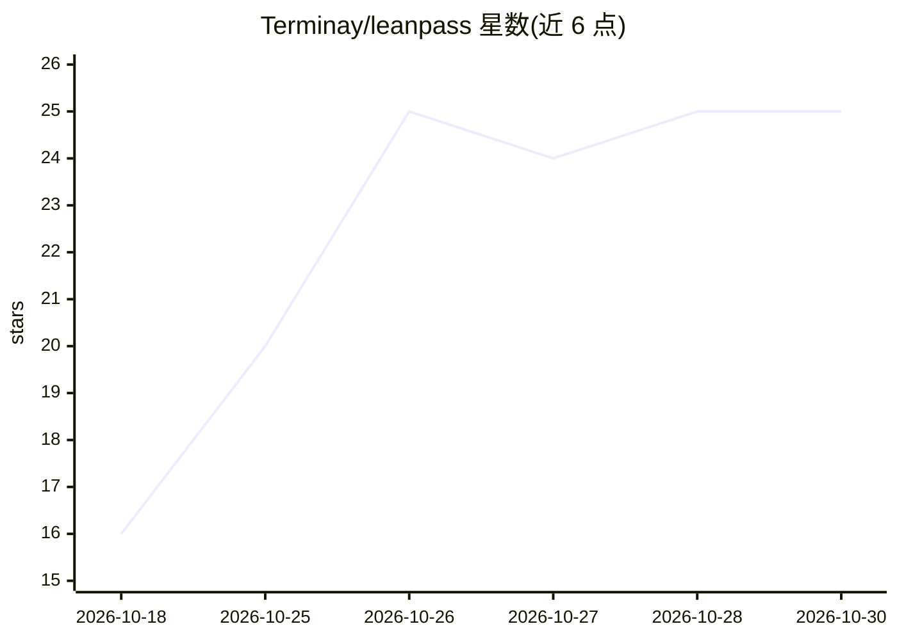

# Terminay/leanpass

⭐ 25 · Python · NOASSERTION · 推送 2026-10-26 · [GitHub](https://github.com/Terminay/leanpass) · [官网](https://leanpass.vercel.app) · 个人维护

**给学习者的 NumPy 自动微分库：透明实现小型神经网络**

基于 NumPy 的轻量反向模式自动微分库，仅依赖 NumPy，提供 Tensor 对象、算术与矩阵运算、激活函数、Linear 层与 MLP、损失函数、SGD/Adam 优化器、Dropout 与索引切片等构件。面向教学、原型验证与小规模神经网绗实验，代码以可读、易检视为设计目标。附带 4 个可运行示例（分类、XOR、MNIST-lite、回归）与 pytest 测试套件，文档站点含 API 参考与 MNIST、梯度检查等指南。核心 API 已稳定。

## 筛选速览

| 维度 | 判定 | 备注 |
|---|---|---|
| AI 角色 | `ai-native` | 本体是模型或模型工具 |
| 许可风险 | `none` | NOASSERTION |
| 部署形态 | `library` | 以包/库形式分发 |
| 模型依赖 | — | README 未给出锁定关系 |
| 硬件要求 | — | 无带数字的原话,不猜 |
| 安装摩擦 | `low` | 无编译、无系统依赖或容器化 |
| 成熟度 | — | 结构信号不足 |

## 能力要点

- 仅依赖 NumPy 的反向模式自动微分 Tensor
- Linear/MLP 层、SGD(momentum/L2)/Adam、Dropout 与可微索引
- 内置 4 个可运行示例与 pytest 测试套件

## 适用场景

- 学习自动微分与神经网络的底层实现
- 课堂教学或作业中演示小型网络训练
- 小规模实验中快速搭建 MLP 做分类/回归

## 场景标签

 · 领域:机器学习库

## 证据(README 行号)

> L13: Leanpass is a lightweight, transparent NumPy-based autodiff library for small neural network experiments. It is des
> L42: - Minimal dependency footprint: only NumPy

## 星数曲线

2026-10-18 16 → 2026-10-30 25（+9）

---
*卡片 v1 · prompt 1.4 · 生成 2026-10-27 · 置信度 high · 依据 README sha `c42583520ee6` · [字段定义](../../DATASET.md)*
