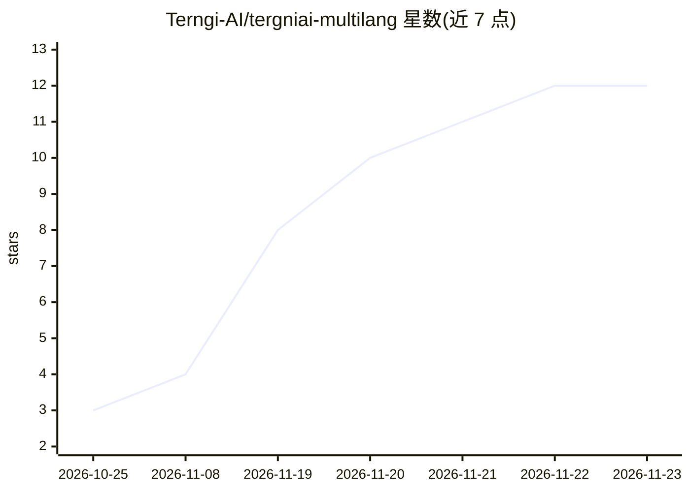

# Terngi-AI/tergniai-multilang

⭐ 12 · Python · MIT · 推送 2026-11-21 · [GitHub](https://github.com/Terngi-AI/tergniai-multilang) · [官网](https://www.terngiai.com) · 组织维护

**面向开发者的 109 语言翻译与 AI 对话自托管 API**

基于 FastAPI 的自托管翻译与对话 API，覆盖 109 种语言（含 27 种非洲语言、印度 22 种官方语言等低资源语言）。提供 /v1/chat、/v1/agent（工具调用）、/v1/converse、批量翻译与语言自动检测端点，内置 Web 聊天页与 WhatsApp 机器人。可同时配置多个提供商，按顺序尝试并自动轮换 API key、跳过失效提供商；支持翻译缓存、API-key 鉴权、限流、Redis 共享缓存与提示注入分类器。MIT 许可，另有面向机构的托管服务 Terngi Kasa。

## 筛选速览

| 维度 | 判定 | 备注 |
|---|---|---|
| AI 角色 | `ai-native` | 本体是模型或模型工具 |
| 许可风险 | `permissive` | MIT |
| 部署形态 | `self-host` | docker 或自建部署 |
| 模型依赖 | local-ok | 支持本地模型 |
| 硬件要求 | — | 无带数字的原话,不猜 |
| 安装摩擦 | `low` | 无编译、无系统依赖或容器化 |
| 成熟度 | — | 结构信号不足 |

## 能力要点

- 109 种语言翻译与多轮对话，源语言自动检测
- 多提供商按序回退与 API key 轮换（Azure/Groq/OpenAI 兼容）
- MORENA 本地模型经 llama.cpp 运行，无需 API key
- WhatsApp 机器人与内置 agent 工具调用端点

## 适用场景

- 为医疗、教育、金融等场景构建多语言聊天应用
- 面向低资源语言用户搭建 WhatsApp 问答机器人
- 自托管多语言文本批量翻译服务

## 场景标签

`聊天机器人` · 领域:对话与助手

## 证据(README 行号)

> L12: **Open-source translation and AI conversation in 109 languages.**
> L51: - **Chat like any AI assistant**: `/v1/chat` and a built-in web chat at `/chat`. Talk about
> L63: - **Free, local model** — run MORENA with llama.cpp for its 14 languages, no API keys needed

## 星数曲线

2026-10-25 3 → 2026-11-23 12（+9）

---
*卡片 v1 · prompt 1.4 · 生成 2026-11-20 · 置信度 high · 依据 README sha `fe061563e046` · [字段定义](../../DATASET.md)*
