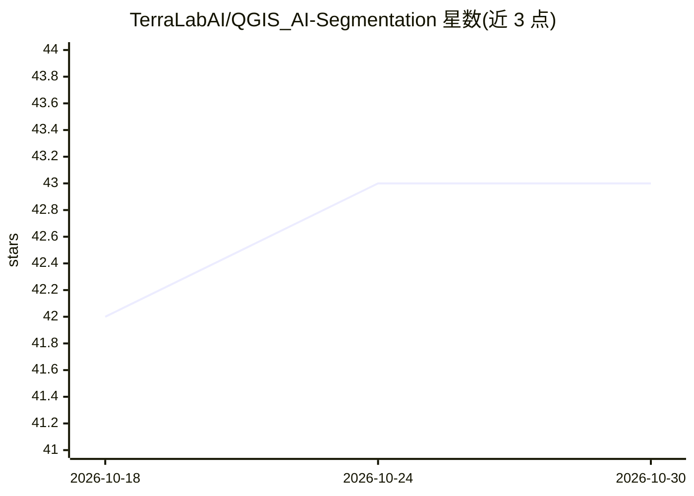

# TerraLabAI/QGIS_AI-Segmentation

⭐ 43 · Python · GPL-2.0 · 推送 2026-10-16 · [GitHub](https://github.com/TerraLabAI/QGIS_AI-Segmentation) · [官网](https://terra-lab.ai/ai-segmentation) · 组织维护

**QGIS 插件：点击或命名对象，从影像生成矢量多边形**

面向 QGIS 用户的影像分割插件，由 TerraLab 维护。两种模式：Automatic 在绘制区域内按对象名称（建筑物、树木、太阳能板等）批量生成矢量多边形，运行于 TerraLab 欧洲服务器，无需 GPU；Semi-Auto 点击对象并加点修正得到轮廓，可选本地离线运行或云端运行。支持 GeoTIFF/JPG/PNG 与 WMS/XYZ 在线底图，输出 GeoPackage/Shapefile/GeoJSON。免费额度每月 1.5 km²（Automatic）+20 个对象（Semi-Auto），本地 Semi-Auto 不计量，超量按付费方案。云端模式会将影像裁片发送至其服务器。

## 筛选速览

| 维度 | 判定 | 备注 |
|---|---|---|
| AI 角色 | `ai-native` | 本体是模型或模型工具 |
| 许可风险 | `viral` | GPL-2.0 |
| 部署形态 | `None` |  |
| 模型依赖 | — | README 未给出锁定关系 |
| 硬件要求 | — | 无带数字的原话,不猜 |
| 安装摩擦 | `low` | 无编译、无系统依赖或容器化 |
| 成熟度 | — | 结构信号不足 |

## 能力要点

- Automatic 模式按名称批量检测并输出矢量多边形，云端运行无需 GPU
- Semi-Auto 模式点击+正负点交互提取轮廓，可选本地离线
- 读取 GeoTIFF/JPG/PNG 与 WMS/XYZ 在线底图，导出三种矢量格式
- 内建后处理：直角化、收缩/扩张、简化、填洞等编辑前审阅功能

## 适用场景

- 在 QGIS 中从航拍/卫星影像提取建筑足迹、太阳能板、树木等矢量数据
- 用半自动点击方式快速勾画单个地物轮廓替代手工描绘
- 批量检测一片区域内的同类地物并导出为可编辑矢量格式

## 场景标签

`目标检测` · 领域:感知与多模态

## 证据(README 行号)

> L5: Click one object and get its outline as a polygon. Or name what you want
> L15: - **Automatic mode**: draw a zone on your imagery, type the object ("buildings", "trees", "solar panels") and get e
> L16: - **Semi-Auto mode**: click an object, add positive and negative points, get a clean outline. Choose *My computer* 

## 星数曲线

2026-10-18 42 → 2026-10-30 43（+1）

---
*卡片 v1 · prompt 1.4 · 生成 2026-10-25 · 置信度 high · 依据 README sha `7f5b837a3bde` · [字段定义](../../DATASET.md)*
